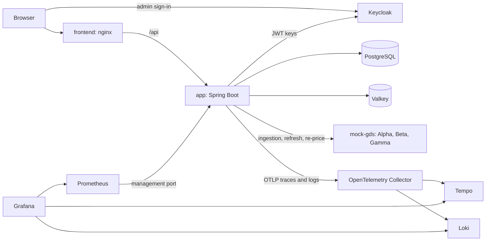

# Solution

How the flight aggregator is built, and why. Each paragraph states a decision, its reason and the alternative rejected, and links to the section of the [design spec](docs/planning/design-spec.md) that argues it in full. Each measured figure links to the progress report that recorded it. To run the system, see the [README](README.md).

> **Draft.** Some parts are still being built. A bracketed note such as *[recorded in plan 7 Task 10]* marks a figure that a later task will produce; no estimate stands in for it.
<!-- TODO(plan 7 Task 10): remove this note once every placeholder below is filled. -->

At a glance:
- Providers sell legs. Every 30 minutes (a setting) a job downloads all three, builds about a million itineraries and publishes them into PostgreSQL in one atomic switch.
- Search reads only PostgreSQL and Valkey, page by page with keyset pagination, so a provider outage never fails a search.
- Re-price on selection confirms the price live before anything is sold.
- Keycloak guards the admin side; metrics, traces and logs meet in one Grafana.
- Built with Claude Code under my direction: I took the design decisions; the agent wrote the code test first, and subagents reviewed every task ([AI usage](#8-ai-usage)).

## 1. Architecture

**Hexagonal modules with explicit ports on both sides.** The Gradle modules are `domain`, `application`, `adapters:providers`, `adapters:persistence`, `adapters:web` and `bootstrap`, plus `mock-gds` (the three providers) and `frontend` (the dashboard, an npm project). Every use case is an inbound port backed by one service; every external dependency, the clock included, is an outbound port. Gradle enforces the direction between modules and seven ArchUnit rules enforce the packages: the domain depends only on the JDK and never reads the clock or a random source, and adapters reach the application only through ports, never each other. The domain rules stay testable without a framework, and the live session can change one adapter without touching the rest. The user chose idiomatic Spring in the application layer (`@Service`, `@Transactional`) over a framework-free core ([session 07](docs/ai/sessions/07-plans-review-protocol-and-foundations.md)). The cost, one interface per use case, buys a hexagon that is visible and checked. ([§6](docs/planning/design-spec.md#6-architecture-hexagonal--ddd); [architecture overview](docs/architecture/README.md))

**Four flows.** *Ingestion:* a scheduled job downloads the providers in parallel, stores each one's offers, deduplicates them, builds every itinerary and copies it into PostgreSQL ([Ingestion](docs/architecture/ingestion.md)). *Search:* `GET /api/itineraries` serves a cached first page from Valkey or runs one keyset query; a stale origin triggers one background refresh. *Re-price:* `POST /api/itineraries/{id}/reprice` quotes the chosen legs live. *Admin:* provider status and a manual run, for the `ADMIN` role ([Search API](docs/architecture/search-api.md)).

**The stack.** Java 25, Spring Boot 4.1, PostgreSQL 18, Valkey 9, Resilience4j's circuit breaker and time limiter, Spring Framework 7's built-in retry and concurrency limit, and React with TypeScript and Vite. Each is the newest stable release at least 14 days old, pinned, because a deadline leaves no room for someone else's framework bug. One exception, accepted by the user: OpenTelemetry's Logback appender, which is published only with an `-alpha` suffix, its marker for the module's API stability; the alternative was an appender of our own ([plan 7, Global Constraints](docs/planning/plans/2026-11-15-observability-and-delivery.md#global-constraints)). Rejected: the agent's first proposal, Java 21 with Spring Boot 3, already out of open-source support ([session 03](docs/ai/sessions/03-grill-me-design-decisions.md)); Redis 8 (AGPL), where Valkey is BSD-licensed and protocol-compatible; and Thymeleaf with htmx, which could not prove that the public API stands on its own. ([§6.1](docs/planning/design-spec.md#61-technology-stack-decided-in-the-grill-me-q1); [§6.8](docs/planning/design-spec.md#68-frontend-dashboard-decided-in-the-grill-me-q8))

**Adapters as an anti-corruption layer.** The hiring team left the schemas to us, so the three differ as legacy systems do: Alpha sends flat JSON with decimal-string prices and a cursor, Beta nested XML with prices in cents and page numbers, Gamma CSV with a header row, by offset. Each adapter translates into the domain's `Leg`, so no external format reaches the domain, and a fourth provider is one adapter and one enum constant. A malformed record is discarded alone, counted and logged with its reason. Gamma's header lets the parser read columns by name; rejected: a header-less CSV, where an added column silently corrupts the parsing. ([§6.7](docs/planning/design-spec.md#67-provider-payload-schemas-decided-in-the-grill-me-q7))

## 2. Modelling

**Providers sell legs; itineraries are built once, at ingestion.** Providers return individual legs, the pattern the hiring team recommended, and one `ItineraryBuilder` owns the connection rules. Pagination over a million rows only makes sense over a stored result, so itineraries are materialised when the inventory is ingested. Rejected: ready-made itineraries from the providers (not how a GDS works), and building them at query time (a graph search per page, and fragile keyset pagination). ([§5.2](docs/planning/design-spec.md#52-provider-payload-model); [§5.3](docs/planning/design-spec.md#53-where-itineraries-are-built--decided-grill-me-q2-materialised-at-ingestion))

**An itinerary is one to three connecting legs and never visits an airport twice.** Legs connect at the same airport, 45 minutes to 24 hours apart, measured between instants, and a departed leg is never sold. The last rule came from the data: 277,605 of the 999,466 itineraries in the first dataset visited an airport twice, such as MAD→LHR→MAD→BCN ([progress 2026-11-13](docs/planning/progress/2026-11-13.md#dataset-statistics-default-config-seed-20261116-clock-2026-11-13t1200z)). Rejected: keeping them; they pass every connection rule, but no traveller buys one. ([§4](docs/planning/design-spec.md#4-domain-rules-confirmed))

**Deduplication picks one offer per flight, whatever the order of arrival.** The same carrier, flight number, origin, destination and departure instant is one flight. The cheapest offer wins; at equal price, the latest quote, as the likeliest to hold; then the provider declared first. A provider that gives one flight two arrival times contradicts itself, and all its offers of that flight are discarded and counted. Rejected: the lowest provider id on a tie, the plan's first proposal, which the user changed ([session 08](docs/ai/sessions/08-domain-plan-and-run.md)). ([§4](docs/planning/design-spec.md#4-domain-rules-confirmed))

**An itinerary's id is a name-based UUID of its legs.** The price is not part of it, so the id survives every run and re-price, and an older cursor or re-price request still finds its itinerary. Rejected: a sequence, which would renumber the inventory on every run; the UUID costs 16 bytes instead of 8. ([§4](docs/planning/design-spec.md#4-domain-rules-confirmed))

**Price: the legs plus 5%, in euros, rounded to cents once, half-up.** Customers expect half-up. Half-even only avoids a bias when many rounded amounts are summed, which never happens here. A price with a third decimal is rounded on read instead of losing the offer; a zero or negative price is rejected; and `Money` refuses an absurd amount before rounding it, so a malformed `1E+999999999` cannot cost seconds of CPU. Rejected: half-even, and rejecting a third decimal. ([§4](docs/planning/design-spec.md#4-domain-rules-confirmed); [§11](docs/planning/design-spec.md#11-left-to-the-builder))

**An itinerary is as fresh as its oldest leg quote.** While a provider is down its legs are kept, so one itinerary can mix fresh and old legs, and its total is only as recent as its oldest part. Rejected: the newest quote, which would hide that part of the price is old. ([§4](docs/planning/design-spec.md#4-domain-rules-confirmed))

**Reference data the domain controls.** The aggregator keeps its own airport catalogue, versioned as a Flyway migration; a leg to an airport missing from it is discarded and counted, because the mock's `ZZZ` passes any IATA format check. The providers are a closed enum, so a typo fails instead of passing silently; rejected: free-form provider names ([session 08](docs/ai/sessions/08-domain-plan-and-run.md)). The dashboard suggests the dataset's 32 airports in From and To and its 12 airlines in Airline, and sends a typed city or airline name as its code; a test keeps those lists equal to the catalogue and to the mock's airlines ([Dashboard, Search](docs/architecture/dashboard.md#search--public)). ([§4](docs/planning/design-spec.md#4-domain-rules-confirmed))

**Mixed airlines are allowed; the Carrier filter wants every leg.** Interlining is valid, as at real OTAs. Filtering by carrier returns only trips it operates end to end, and the generated network puts each airline on its hubs, so 38,227 of 94,639 direct and one-stop itineraries (40.4%) have one airline ([progress 2026-11-14](docs/planning/progress/2026-11-14.md#before--after-default-config-seed-20261116-clock-2026-11-13t1200z)). Rejected: "any leg on that carrier"; someone who filters by an airline wants to fly with it ([session 04](docs/ai/sessions/04-autonomous-work-and-tdd.md)). ([§4](docs/planning/design-spec.md#4-domain-rules-confirmed))

## 3. Ingestion and freshness

**A hybrid model: a periodic job, a background refresh of stale routes, and the last good data on failure.** Search reads only our store and answers in milliseconds whatever the providers do. Rejected: calling the providers on every search, which makes each one as slow as the slowest provider (up to 5 s) and leaves nothing to paginate; and a pure pre-computed inventory, with no answer to failure. The cost, a slightly stale price, is bounded by the cadence and covered by re-price. Each mock exposes its whole inventory, paginated, since a query by route never returns the legs through intermediate airports. ([§5.1](docs/planning/design-spec.md#51-ingestion-model); [§4.1](docs/planning/design-spec.md#41-inventory-time-and-volume-decided-after-the-builder-check))

**Two slots, one switch.** Search reads `itinerary_a` or `itinerary_b`, whichever `inventory_publication` names. In one transaction, a run truncates the other slot, streams every itinerary into it with `COPY`, analyses it, and switches the active slot and the generation. Any failure rolls back, so search never sees a half-loaded slot, and no `DELETE` leaves dead rows. A provider's stored offers change only when its whole download succeeded. Rejected: JPA; the user chose `JdbcClient` with `COPY` from a side-by-side comparison ([session 09](docs/ai/sessions/09-lost-sessions-and-recovery.md)). ([§6.5](docs/planning/design-spec.md#65-provider-outages-decided-in-the-grill-me-q5); [Ingestion, the slots](docs/architecture/ingestion.md#the-slots))

**Daily partitions.** Each slot is partitioned by departure day, from today to today plus 37 (the 30-day window and 7 spare days), with a `DEFAULT` partition that takes any row whose day has none instead of failing the insert; a reload drops past days. The data expires by day, dropping a partition costs no scan, and `departure > now` skips past ones. Metrics and alerts watch the days ahead and the rows in `DEFAULT`. Rejected: a periodic `DELETE`, whose dead rows bloat the indexes and slow the keyset scans; and weekly or monthly partitions, which hold up to 29 days of dead rows. ([§4.3](docs/planning/design-spec.md#43-why-partition-by-departure-day))

**Downloads with two time bounds.** The providers download in parallel on virtual threads. Each request is cut at 2.5 s and retried twice on a 5xx, timeout or I/O error, through the provider's circuit breaker, and a time limiter ends a provider's whole download at 60 s. With request timeouts alone, a provider that is slow but never fails could stretch a run to about 27 minutes, and its breaker would never open. Rejected: the request timeout alone, the controller's first recommendation, reversed when the user asked whether the other option was not more complete ([session 09](docs/ai/sessions/09-lost-sessions-and-recovery.md)). ([§6.1](docs/planning/design-spec.md#61-technology-stack-decided-in-the-grill-me-q1))

**The stale-route refresh rewrites one origin in place.** A search whose origin is over 10 minutes old claims it in Valkey (`SET NX`) and asks for one background refresh, so a thousand such searches cause one refresh and none waits for it. The refresh downloads that origin's legs, rebuilds the itineraries with a leg leaving from it, swaps them into the active slot in one transaction and increments the generation. Rejected: rebuilding the whole slot per refresh, a full run each time ([plan 5, Q2](docs/planning/plans/2026-11-15-search-api.md#open-questions-for-the-user)). A refresh of a hub rewrites half the inventory: Madrid's took 15.0 s for 530,603 of 1,033,722 itineraries, holding the publication row for 13.9 s, and two of three refreshes started at once failed on the row's lock timeout ([progress, plan 5 Task 13](docs/planning/progress/2026-11-15-search-api.md#task-13--evidence)). So one refresh runs at a time in the whole application, under its own lock: a refresh asked for while another runs is skipped before it downloads anything and gives its claim back, so a later search asks again. Of 32 origins searched at once, one refresh ran and the rest were skipped, with every search answered within 0.5 s ([progress, plan 5 closing round 1](docs/planning/progress/2026-11-15-search-api.md#end-of-plan-fix-round-1--importants)). The user chose this over the other options Task 13 listed: a refresh that waits for the row as a run does, or one that skips only once it finds the row held ([plan 5, the user's decision](docs/planning/plans/2026-11-15-search-api.md#decided-by-the-user-at-the-end-of-plan-review-2026-11-16-about-0545)). A refresh also obeys the run's ceiling on itineraries: past it, its rewrite rolls back ([plan 5, closing round 3](docs/planning/progress/2026-11-15-search-api.md#end-of-plan-fix-round-3)). ([§4.1](docs/planning/design-spec.md#41-inventory-time-and-volume-decided-after-the-builder-check); [§6.4](docs/planning/design-spec.md#64-refresh-cadence-and-staleness-bounds-decided-in-the-grill-me-q4))

**The cadence and the measured run.** A full run every 30 minutes, a 10-minute freshness threshold per origin, and a 5-minute Valkey TTL, below the threshold so the cache never extends staleness: searched origins are at most about 10 minutes old, the rest about 30. Plan 4's run published 1,021,205 itineraries in 14.4 s on a cold JVM and 11.9 to 12.0 s on later runs, with the app at 316 MiB under `-Xmx512m` ([progress 2026-11-15, Task 11](docs/planning/progress/2026-11-15.md#task-11--evidence)). The search's sort indexes made it slower, and it still fits: 23.8 to 27.5 s with six per slot ([plan 5 Task 13](docs/planning/progress/2026-11-15-search-api.md#task-13--evidence)), 34.9 to 41.6 s with today's twelve on a host shared with another stack ([plan 5's re-review fixes](docs/planning/progress/2026-11-15-search-api.md#end-of-plan-fix-round-1--re-review-fixes)). So the database is not what limits the cadence. Each run downloads every provider's whole inventory, which with a real GDS means calls under a quota or paid for, and starts a new generation, which empties the Valkey cache. What people search is kept fresher by the per-origin refresh, and the price at purchase by the re-price, so the rest can wait 30 minutes. The cadence is a setting (`ingestion.interval`), to be tuned on measurements: the cost of a run (`ingestion.duration`, `provider.calls`) against how searches use the inventory (`http.server.requests`, the cache hit ratio). Demand per route is not measured yet; it is the next metric production would add. Rejected: running every 10 minutes, which triples the providers' load and empties the cache three times as often, for inventory nobody is looking at; and every hour or more, which leaves a route nobody has searched yet up to an hour old. ([§6.4](docs/planning/design-spec.md#64-refresh-cadence-and-staleness-bounds-decided-in-the-grill-me-q4))

## 4. Pagination at 1M

**Keyset pagination, never offset.** Each page asks for the rows after the last one seen, `(key, id) > (?, ?) ORDER BY key, id`, with the itinerary id breaking ties, so a page costs one index seek at any depth. A test pages through 25 itineraries at one price, ten at a time, and finds each exactly once. Rejected: offset, whose cost grows with depth. ([§5.4](docs/planning/design-spec.md#54-pagination))

**One index per sort order, for each way of searching.** Price (the default), departure and duration each have an index ending in the id: alone, behind `(origin, destination)`, behind the origin alone and behind the destination alone, twelve per slot. Origin and destination together are the typical search; without the prefix, a rare route sorted by departure would walk about 30 partitions' departure indexes, discarding most rows. Plan 5 started with the first six, rejecting four indexes or adding them only where a measurement shows a slow query ([plan 5, Q6](docs/planning/plans/2026-11-15-search-api.md#open-questions-for-the-user)). Its end-of-plan reviews then found that gap: an origin searched without a destination walked the slot's whole price index (JFK by price, 948 ms warm and up to 1,351 ms cold), and a destination without an origin did the same (3 to 4 s on a busy host), against a read's 2 s bound. The user added the six single-airport indexes; with them those pages took 0.3 to 7.1 ms warm ([progress, plan 5 closing round 1](docs/planning/progress/2026-11-15-search-api.md#end-of-plan-fix-round-1--importants); [its re-review fixes](docs/planning/progress/2026-11-15-search-api.md#end-of-plan-fix-round-1--re-review-fixes)). Each index slows every `COPY`. With six, a run took 23.8 to 27.5 s against plan 4's 12 to 14 s; in one of them the `COPY` took 15.0 s and `ANALYZE` 5.1 s ([progress, plan 5 Task 13](docs/planning/progress/2026-11-15-search-api.md#task-13--evidence)). With twelve, on a host shared with another stack, it took 34.9 to 41.6 s, and 31.4 to 33.6 s minutes later with the destination indexes dropped. A run still fits the 30-minute cadence many times over ([its re-review fixes](docs/planning/progress/2026-11-15-search-api.md#end-of-plan-fix-round-1--re-review-fixes)). ([§5.4](docs/planning/design-spec.md#54-pagination))

**A merge across about 30 partitions.** A price-sorted page spans every day partition, and PostgreSQL answers with a Merge Append: one index seek per partition, then a merge. Planning time only matters with hundreds of partitions; a year's horizon would be measured again. Rejected: coarser partitions, which keep dead rows in the indexes. Plan 5 Task 13 ran `EXPLAIN (ANALYZE, BUFFERS)` on 1,033,722 itineraries in 39 partitions, for the first and the fiftieth page of each sort order, with no filter, an origin, a route and a carrier. Every plan was a `Limit` over a `Merge Append` of index scans, one per partition, with no sequential scan. Warm, 23 of the 24 statements took 0.2 to 14.7 ms; the slowest, departure order with an origin alone, took 42 ms, before its origin index existed. Right after a refresh, its dead rows cost the first reader up to 321 ms, until autovacuum cleared them within two minutes. Over HTTP, an uncached first page answered in 9 to 60 ms (the first request after startup, 104 ms) and a cached one in 4.6 to 6.8 ms; fifty pages through their cursors gave 1,000 rows with none repeated, at a median of 5.0 ms a page by price and 16.8 ms by departure from Madrid ([progress, plan 5 Task 13](docs/planning/progress/2026-11-15-search-api.md#task-13--evidence)). ([§4.3](docs/planning/design-spec.md#43-why-partition-by-departure-day))

**An opaque cursor that carries the generation.** It encodes, in base64url, a format version, the generation, the sort order, and the last row's price, departure, duration and id. A malformed cursor, one over 200 characters or one of another sort order answers 400, never a wrong page. Rejected: signed cursors, since a forged one only seeks within public data and is validated anyway ([plan 5, extras](docs/planning/plans/2026-11-15-search-api.md#-extras--your-call)). ([§5.4](docs/planning/design-spec.md#54-pagination))

**A changed inventory is flagged, not hidden.** Prices change in place, so a user paging by price could see an itinerary twice or never. When a cursor's generation is no longer active, the page continues from its position with `inventoryChanged: true`, and the dashboard offers "results updated, reload". Rejected: full snapshots, which would copy a million rows per run, and paging the old generation in the inactive slot, which would help only across full runs, since every refresh changes the active slot in place ([plan 5, Q1](docs/planning/plans/2026-11-15-search-api.md#open-questions-for-the-user)). ([§6.3](docs/planning/design-spec.md#63-price-volatility-decided-in-the-grill-me-q3))

**"Load more", no total.** eDreams ends its results with a "Load more deals" button, which fits a cursor that only knows the next page; the header shows "Showing N flights". Rejected: page numbers, which need offset and a count over a million rows, and infinite scroll, which takes the footer away from keyboard and screen-reader users. ([§5.4](docs/planning/design-spec.md#54-pagination))

## 5. Caching, outages, re-price, security and observability

**Two cache levels.** PostgreSQL caches the providers' inventory: the job refreshes it ahead of time, and a stale origin is served as it is while it refreshes. Providers are slow and fail, searches outnumber bookings by orders of magnitude, and every real GDS query costs money. Valkey caches search results (cache-aside, 5-minute TTL, `allkeys-lru`) under keys that include the generation, so a publication invalidates every key with no scan or delete. Only first pages without Max Price are cached, since typed amounts rarely repeat. Valkey also holds the refresh claims and the rate-limit counters, shared across API instances. Rejected: a local or two-level Caffeine cache (instances would serve different generations and could not coordinate), Valkey as the source of truth, and the job's lock in Valkey (it stays in PostgreSQL). ([§6.2](docs/planning/design-spec.md#62-caching-strategy-decided-in-the-grill-me-q3); [plan 5, Q3](docs/planning/plans/2026-11-15-search-api.md#open-questions-for-the-user))

**The honest note on Valkey.** At a million rows, a well-indexed PostgreSQL would cope alone; Valkey earns its place through horizontal scaling and coordination, not the demo's volume. The evidence would be the hit ratio, which is a metric with its own Grafana panel, but it has not been measured under realistic traffic: a synthetic load with a realistic route mix was too big a change for delivery day, and is in the [extras backlog](docs/planning/extras-backlog.md). And the system works without Valkey: every call fails open (a miss, an unclaimed refresh, an admitted request), and after a failed command a circuit breaker skips Valkey for 10 s. A hung Valkey thus costs one 250 ms timeout per 10 s instead of up to five per search, about 1.25 s; with Valkey paused, each call returns its fallback within 500 ms ([progress, plan 5 Task 5](docs/planning/progress/2026-11-15-search-api.md#task-5--evidence)). With the Valkey container stopped, twelve repeats of a search whose first page had been cached answered in 3.8 to 10.7 ms (4.4 to 28.9 ms with Valkey up), and two new searches in 15 and 29 ms: a disconnected client refuses commands at once, so no timeout was paid. Health read `DEGRADED` with HTTP 200, and the cache came back on its own when Valkey did ([progress, plan 5 Task 13](docs/planning/progress/2026-11-15-search-api.md#task-13--evidence)). ([§6.2](docs/planning/design-spec.md#62-caching-strategy-decided-in-the-grill-me-q3))

**Outages degrade visibly, never silently.** Search works with one, two or three providers down, and every result shows its age. A failed provider's last good offers are kept, also when its download arrives whole but holds no usable leg, so its itineraries never vanish. Health reports `DEGRADED` with HTTP 200, so an orchestrator does not restart an API that still serves; it answers `DOWN` with 503 only when PostgreSQL is out of reach. The API port's `/health` leaves out Boot's `db` component, since the inventory's own component already reads PostgreSQL, so a probe waits once for a connection and answers in about 2 s instead of 4 s, inside compose's 5 s check; the management port's `/actuator/health` keeps `db` ([plan 5, the user's decision](docs/planning/plans/2026-11-15-search-api.md#decided-by-the-user-on-the-health-probes-time-2026-11-16-about-0858)). A run with no fresh provider counts as failed, so the outage alert fires. With Beta failing every request, a run still published 1,021,094 itineraries, using Beta's 3,579 offers from the run before ([progress 2026-11-15, Task 11](docs/planning/progress/2026-11-15.md#task-11--evidence)). Rejected: deleting a failed provider's legs, and reporting `DOWN` while search works. ([§6.5](docs/planning/design-spec.md#65-provider-outages-decided-in-the-grill-me-q5))

**Re-price confirms the price before selling.** Choosing an itinerary re-quotes its legs live, under the same timeouts and breakers, and answers `CONFIRMED`, `PRICE_CHANGED` with the previous price, or `ALTERNATIVE`; the stored itinerary takes the new price. A leg whose provider fails is quoted from another provider's offer of the same flight; failing that, the next cheapest confirmable itinerary of the route comes with *"We couldn't confirm this flight. This is the best alternative we found."* Only when nothing can be confirmed does it answer 503 with `Retry-After`. The user's rule: never sell at an unconfirmed price, and always give the customer a result. During an ingestion run the customer still gets the live price; storing it is skipped, logged and counted. Rejected: a new generation per re-price, which would flush the cache and flag every user's pagination on each click ([plan 5, Q5](docs/planning/plans/2026-11-15-search-api.md#open-questions-for-the-user)). Measured on the real volume: with every provider up, re-price answered `CONFIRMED` or `PRICE_CHANGED` in 0.13 to 1.03 s. With Beta failing every request, a flight Beta shared with another provider came back `PRICE_CHANGED` from the other's offer in 5.8 s, and a flight only Beta sold came back `ALTERNATIVE`, with the notice, in 1.5 s. With every provider stopped, three re-prices answered 503 with `Retry-After: 60` in 13.8 s, 1.35 s and 0.02 s, and no stored row changed. The first passed the 10 s budget by one quote already in flight, since the budget stops only new quotes; the breakers then opened, so the next answers were fast. The user kept this as built ([progress, plan 5 Task 13](docs/planning/progress/2026-11-15-search-api.md#task-13--evidence); [plan 5, the user's decision](docs/planning/plans/2026-11-15-search-api.md#decided-by-the-user-at-the-end-of-plan-review-2026-11-16-about-0545)). ([§6.3](docs/planning/design-spec.md#63-price-volatility-decided-in-the-grill-me-q3); [§6.5](docs/planning/design-spec.md#65-provider-outages-decided-in-the-grill-me-q5))

**Search is open; admin needs OAuth2.** A real OTA does not ask for a login to search, so search and re-price are public, rate-limited per client IP against scraping (60 searches and 10 re-prices a minute, then 429 with `Retry-After`); `X-Forwarded-For` counts only from a private-range proxy, so a client on the internet cannot choose its own counter ([limitations](#7-assumptions-and-limitations)). Admin endpoints need a Keycloak JWT with the role `ADMIN`, checked through Spring Boot's own resource-server settings, so another identity provider is a configuration change. People sign in through the dashboard with Authorization Code and PKCE. Scripts, and a reviewer without the author, get a token from the `admin-service` client with the client-credentials grant and call the admin endpoints with it; the README gives the commands. Each mock provider asks for its own API key. Rejected: a login to search, a static admin key, and the password grant, which OAuth 2.1 removes. ([§6.6](docs/planning/design-spec.md#66-authentication-and-access-control-decided-in-the-grill-me-q6); [README, admin access](README.md#admin-access))

**Three signals in one Grafana, for the whole team.** Metrics cover what the other sections promise: provider calls and breaker states, freshness per provider, ingestion duration, cache hit ratio, discarded records and partition health, with low-cardinality tags only. Traces follow one search or ingestion run across threads (OpenTelemetry through Spring Boot, W3C `traceparent`). JSON logs carry trace, span and correlation ids and reach Loki through the Collector, with a jump from a log line to its trace. The people who run a service read its metrics, so the team opens Grafana as anonymous Viewers, who may explore but never save; Prometheus scrapes a management port that only compose's network reaches. Four rules alert, with no notification channel: three failed runs in a row, a provider's data older than 90 minutes, fewer than 34 days of partitions ahead, any row in `DEFAULT`; a missing or `NaN` gauge counts as stale. Telemetry never blocks a request. Rejected: metrics for `ADMIN` only, reversed by the user ([session 09](docs/ai/sessions/09-lost-sessions-and-recovery.md)); reading logs through Docker's files or socket; Alertmanager and SLO burn-rate alerts. How each part works and is tested is in [Observability](docs/architecture/observability.md). <!-- TODO(plan 7 Task 10): if extras E1 (a link from a trace to its logs), E4 (a logs panel and an alert list on the dashboard) and E5 (an HTTP panel) are on main, say so here; they were still being built when this paragraph was written. --> ([§6.10](docs/planning/design-spec.md#610-observability-decided-in-the-grill-me-q9); [plan 7, Q1–Q4](docs/planning/plans/2026-11-15-observability-and-delivery.md#open-questions-for-the-user))

## 6. Testing and quality gates

**Test first, one test at a time, with the evidence on record.** Every production change starts with one test, seen failing for the expected reason, then the least code that passes it; each red and green goes into the day's [progress report](docs/planning/progress/), so commits stay green. Reviewers ask each test to fail under a named, plausible wrong implementation, because most findings in the domain run were tests that could not tell a right rule from a wrong one ([session 08](docs/ai/sessions/08-domain-plan-and-run.md)). When a dropped session loses evidence, the agent re-establishes it by breaking the code and labels it "recorded after the fact by mutation". Rejected: a reminder in each prompt, after an agent wrote tests ahead of the code ([session 04](docs/ai/sessions/04-autonomous-work-and-tdd.md)). ([§8](docs/planning/design-spec.md#8-testing-strategy))

**Real dependencies in the tests.** Integration tests run against PostgreSQL, Valkey and Keycloak in Testcontainers and against providers in WireMock, ingestion included with one, two and three providers down. Compose, the Prometheus rules and Grafana's provisioning are tested in `./gradlew build` against the images that run them, and Playwright with axe drives the dashboard against `docker compose`. Rejected: in-memory fakes, which would not run `COPY`, the partitions or the keyset queries as PostgreSQL does. ([§6.1](docs/planning/design-spec.md#61-technology-stack-decided-in-the-grill-me-q1); [§8](docs/planning/design-spec.md#8-testing-strategy))

**Gates that fail the build.** Eight ArchUnit rules, the seven package rules and a ban on Jackson 2 in the application's classes, each run against classes that break it, so a rule that stops detecting fails too. JaCoCo demands 90% of lines and 80% of branches over unit and integration tests; 90% of branches would force worthless tests of defensive code. Spotless applies google-java-format; the frontend runs strict TypeScript, ESLint, Prettier and Vitest. CI runs all of it on every push, plus the contract-drift check, the image builds and the end-to-end tests, and a GitHub ruleset refuses force pushes to `main`. Rejected: mutation testing with PIT and a frontend coverage gate (not approved), and full branch protection, which would block the agents' pushes. Final counts and coverage: *[recorded in plan 7 Task 10]*. <!-- TODO(plan 7 Task 10): the final test counts per module, frontend and end-to-end, and the JaCoCo coverage, from its Step 4 (`./gradlew build --rerun-tasks`, `npm run verify`, `npm run e2e`). Known so far: CI's full end-to-end job, in the new order with the observability project, took 10 min in run 43847065593 on `d37b894`; cite it from the progress report that records it. --> ([§6.11](docs/planning/design-spec.md#611-continuous-integration-decided-in-the-grill-me-q10))

## 7. Assumptions and limitations

Assumptions, where the brief left a choice open:
- Trips are one way, in euros ([session 01](docs/ai/sessions/01-requirements-clarification.md); [§2](docs/planning/design-spec.md#2-goals-non-goals-anti-goals)).
- At most two stops, to bound the combinations ([session 02](docs/ai/sessions/02-team-answers-and-project-plan.md)).
- The Carrier filter means the carrier operates every leg; no codeshare ([session 02](docs/ai/sessions/02-team-answers-and-project-plan.md)).
- Provider times are ISO-8601 with a UTC offset ([§4.2](docs/planning/design-spec.md#42-why-iso-8601-with-offset)).
- The mocks generate a rolling 30-day window, sized to about a million itineraries ([§4.1](docs/planning/design-spec.md#41-inventory-time-and-volume-decided-after-the-builder-check)).
- Gamma's "comma-separated string streams" is a whole CSV body, read line by line ([session 01](docs/ai/sessions/01-requirements-clarification.md)).
- The 5% markup applies after the cheapest offer is chosen ([session 01](docs/ai/sessions/01-requirements-clarification.md)).
- A connection needs 45 minutes at any airport and lasts at most 24 hours; the hiring team confirmed this definition of invalid connections ([session 02](docs/ai/sessions/02-team-answers-and-project-plan.md)).
- The "real-time dashboard" is an interactive search used as a customer would use it ([session 01](docs/ai/sessions/01-requirements-clarification.md)).

Limitations, accepted on purpose:
- **Local times from real GDSs.** Real schedule formats often send local times and rely on airport time zones. We chose offsets for our mocks; a real integration would convert inside its adapter, and the domain would not change ([§4.2](docs/planning/design-spec.md#42-why-iso-8601-with-offset)).
- **The mock dataset is generated once, at startup.** A mock left running for days serves a shrinking window, though its prices still drift per request ([plan 3](docs/planning/plans/2026-11-15-mock-gds-http.md)).
- **Demo secrets are committed.** Provider keys, the database password, the admin client's secret and the demo admin's password are overridable defaults, so one `docker compose up --build` runs everything. They guard only local services; production would inject them from a secret manager ([§6.6](docs/planning/design-spec.md#66-authentication-and-access-control-decided-in-the-grill-me-q6); [README](README.md)).
- **Stored provider offers are not versioned with the generation.** The offers a re-price falls back on can be newer than the inventory the customer searched ([plan 4 close-out](docs/planning/progress/2026-11-15.md#the-controllers-rulings)).
- **A restart can leave a gap, and some counters are per instance.** After a crash mid-run, the restarted app skips its startup run while the dead run's lock lasts (up to 29 minutes), so runs can be nearly an hour apart. The failure count and the partition horizon live in each instance and read `NaN` until its first run; the alert rules treat that as stale and combine instances ([plan 4 close-out](docs/planning/progress/2026-11-15.md#re-review-of-the-fix-wave)).
- **Metrics are open to whoever reaches Grafana.** Production would put Grafana behind the company's sign-in ([§6.6](docs/planning/design-spec.md#66-authentication-and-access-control-decided-in-the-grill-me-q6)).
- **Two known security limits** ([extras backlog](docs/planning/extras-backlog.md#left-by-plan-5s-closing-round-3-the-users-decision-of-2026-11-16-known-limitations-not-built-before-delivery)):
  - `X-Forwarded-For` is trusted from any private address, so a caller on the host or on compose's network can change its rate-limit key. The fix trusts only the proxy's address, which compose would have to fix, or stops publishing the app's port.
  - Admin tokens carry no audience check: any token of the realm with the role `ADMIN` is accepted. The fix is an audience mapper on both realm clients and an `aud` check in the resource server.

## 8. AI usage

Claude Code built the system, and how it was steered is part of the deliverable: the configuration is versioned in [`CLAUDE.md`](CLAUDE.md) and [`.claude/`](.claude), explained in [How this project uses AI](docs/ai/README.md), and each working session is written up in [`docs/ai/sessions/`](docs/ai/sessions/README.md) with the prompts that changed the outcome, translated from Spanish.

**The process.** The agent first read the brief critically: 27 ambiguities, each with a default, of which 4 became questions to the hiring team ([session 01](docs/ai/sessions/01-requirements-clarification.md)). Brainstorming produced the [design spec](docs/planning/design-spec.md), a fresh subagent read it as its builder and found four gaps ([session 02](docs/ai/sessions/02-team-answers-and-project-plan.md)), and grill-me sessions closed each open decision one question at a time, the agent recommending and the user deciding ([sessions 03](docs/ai/sessions/03-grill-me-design-decisions.md) and [06](docs/ai/sessions/06-grill-me-observability-ci-pagination.md)). Each subsystem got a plan from `superpowers:writing-plans`, written just before it started ([roadmap](docs/planning/roadmap.md)), and one implementer subagent per task built it test first, often overnight. The user kept the design decisions and the full scope, rejecting the agent's proposal to leave Redis, the background refresh, auth, observability and CI as documented future work ([session 02](docs/ai/sessions/02-team-answers-and-project-plan.md)).

**Reviewers with one question each.** [`.claude/agents/`](.claude/agents) defines `functional-reviewer` (does it deliver what was asked, and nothing unapproved?), `code-reviewer` (is it maintainable and correct?) and `risk-reviewer` (what fails in production?). The first two reviewed every task; all three reviewed each whole plan, where risks between tasks show. A reviewer was often asked to prove, in a throwaway worktree, the one claim the implementer could not ([session 07](docs/ai/sessions/07-plans-review-protocol-and-foundations.md)).

**The configuration.** [`CLAUDE.md`](CLAUDE.md) binds every agent: the spec as the source of truth, one test at a time with recorded evidence, a review before every commit, the review protocol, and the push and continuity rules. Two project skills were written test first against subagents that lacked them: `brief-scope` makes every proposal source each item and list extras for the user to decide ([session 05](docs/ai/sessions/05-scope-guard-and-agent-skills.md)), and `prompt-log` records a valuable prompt when it happens, not at the end ([session 09](docs/ai/sessions/09-lost-sessions-and-recovery.md)). The rest are the author's review skills and published ones, listed with their origin in [Skills and plugins](docs/ai/README.md#skills-and-plugins). A PreToolUse hook blocks destructive git commands, and a GitHub ruleset backs it up.

**The change of course on Sunday.** At 12:30 the measured pace, 50 to 60 minutes per task with its reviews and fixes, put the end of the last plan at the very end of Monday with no margin. The user chose three changes: independent tasks run in parallel in their own git worktrees, plan 6 was drafted while plan 5 ran, and one reviewer per task gives both the functional and the code verdict, while each plan still ends with three reviewers. TDD, the full suite before every commit, a green CI run after every task and the user's design decisions stayed ([roadmap](docs/planning/roadmap.md#change-of-course-on-sunday-2026-11-15-to-meet-the-delivery-date); [session 09](docs/ai/sessions/09-lost-sessions-and-recovery.md)).

**Continuity after dropped sessions.** A VPN client cut the session several times, and each cut lost the conversation. After the first, the recovery found unpushed commits without evidence and an unrecorded design change; it treated the plan as open, and the reviews caught the change ([session 09](docs/ai/sessions/09-lost-sessions-and-recovery.md)). Since then the agent pushes every finished task, writes every user decision into the repository before moving on, and treats a commit without evidence as open. After a second cut the user asked to "rely on the repository": [`docs/planning/continuation.md`](docs/planning/continuation.md) now records what is in flight, rewritten and pushed at every checkpoint, and each worktree branch is pushed after every commit. The same session found that Claude Code, opened from the folder above the repository, had loaded neither the git hook nor the reviewers; `CLAUDE.md` now says how to check.

**What the reviews and the user's challenges caught:**
- An outdated first stack, after the user asked *"Is this a modern stack? Why Java 21 and not 25? Isn't Spring Boot on version 4?"*; the agent then checked every other component ([session 03](docs/ai/sessions/03-grill-me-design-decisions.md)).
- An overnight subagent writing tests in batches (about 14 red phases for 67 tests), found by asking *"Are you applying TDD?"* and reading the evidence, not the report; the fix became `CLAUDE.md` ([session 04](docs/ai/sessions/04-autonomous-work-and-tdd.md)).
- A date filter (a non-goal) and an unrequested stops filter in the first dashboard sketch, which led to `brief-scope` ([session 05](docs/ai/sessions/05-scope-guard-and-agent-skills.md)).
- A git guard bypassed with `git -C` and an architecture rule passing vacuously behind a package typo, in plan 1 ([session 07](docs/ai/sessions/07-plans-review-protocol-and-foundations.md)).
- A rounding test that half-even also passed, and a builder that restated two domain rules as silent filters, in plan 2 ([session 08](docs/ai/sessions/08-domain-plan-and-run.md)).
- A download with no usable leg that wiped a provider's stored offers, found by all three reviewers of plan 4 ([progress](docs/planning/progress/2026-11-15.md#end-of-plan-review)), and three red CI runs on `main` that a code reviewer found by reading the runs ([session 09](docs/ai/sessions/09-lost-sessions-and-recovery.md)).

<!-- TODO(plan 7 Task 10): link the session record of the work since session 09, which Task 10 writes if none exists, and add any later finding worth naming here. -->
