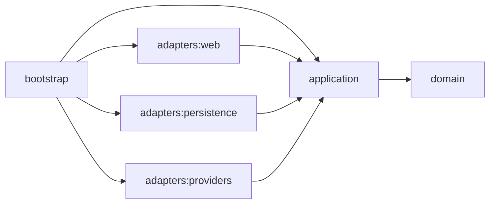

# Architecture

Technical documentation of the system, filled in as it is built:

- **Hexagonal modules and their dependency rules** (enforced with ArchUnit), with Mermaid diagrams.
- **The ingestion and search flows**, from the providers to the dashboard.
- **The domain glossary** (ubiquitous language): leg, itinerary, dead leg, connection, interlining.

The reasoning behind each decision lives in the [design spec](../planning/design-spec.md); `SOLUTION.md`, at the repository root, summarises it for the reader.

## Hexagonal modules

Arrows point from a module to the modules it may depend on. Gradle enforces only this module-level direction; the package rules below are enforced by ArchUnit.

Port rules:

- Inbound ports are interfaces in `com.flightaggregator.application.port.in`; outbound ports are interfaces in `com.flightaggregator.application.port.out`.
- Services in `com.flightaggregator.application.service` implement the inbound ports and call the outbound ports.
- Adapters implement or call ports and never depend on each other.
- The domain depends on nothing, and the application layer may use Spring while the domain never does.
- Only `bootstrap` wires adapters to the application.

ArchUnit rules, in `HexagonalRules` (`architecture-tests`), run by `./gradlew build`:

1. `domainDependsOnlyOnTheJdk`: the domain depends only on the JDK and itself.
2. `applicationDependsOnlyOnTheDomainAndSpring`: the application layer depends only on the JDK, Spring, the domain and itself.
3. `adaptersUseOnlyPorts`: adapters reach the application layer only through its ports (`application.port..`): never a service or any other application class.
4. `adaptersAreIndependent`: no adapter depends on another adapter.
5. `nothingDependsOnBootstrap`: nothing outside `bootstrap` depends on it.
6. `everyClassResidesInALayer`: every class under `com.flightaggregator` (except `mockgds`) lives in one of the eight layer packages (`domain`, `application.port.in`, `application.port.out`, `application.service`, `adapter.provider`, `adapter.persistence`, `adapter.web`, `bootstrap`), so a misnamed package such as `adapters.web` cannot escape the other rules.

Fixtures under `architecture-tests/src/test/java/.../fixture` check each rule against a tiny violating package tree (`HexagonalRulesTest`), so a rule that stopped detecting anything would fail the build.
