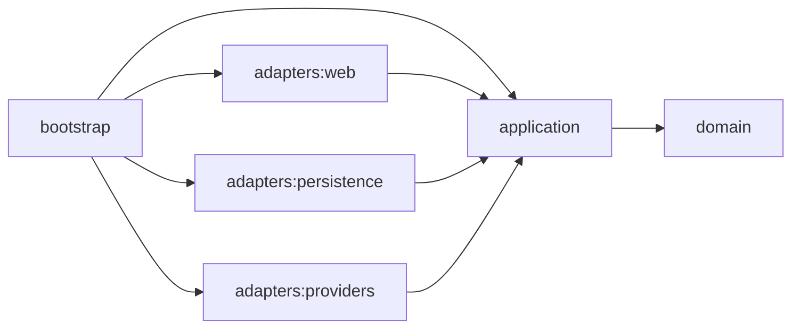

# Architecture

Technical documentation of the system, filled in as it is built:

- **Hexagonal modules and their dependency rules** (enforced with ArchUnit), with Mermaid diagrams.
- **The ingestion and search flows**, from the providers to the dashboard.
- **The domain glossary** (ubiquitous language): leg, itinerary, dead leg, connection, interlining.

The reasoning behind each decision lives in the [design spec](../planning/design-spec.md); `SOLUTION.md`, at the repository root, summarises it for the reader.

## Hexagonal modules

Arrows point from a module to the modules it may depend on; Gradle enforces them, so a forbidden import does not compile.

Port rules:

- Inbound ports are interfaces in `com.flightaggregator.application.port.in`; outbound ports are interfaces in `com.flightaggregator.application.port.out`.
- Services in `com.flightaggregator.application.service` implement the inbound ports and call the outbound ports.
- Adapters implement or call ports and never depend on each other.
- The domain depends on nothing, and the application layer may use Spring while the domain never does.
- Only `bootstrap` wires adapters to the application.
