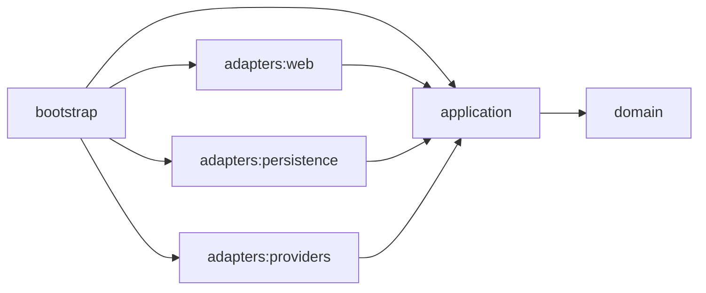

# Architecture

Technical documentation of the system, filled in as it is built:

- **Hexagonal modules and their dependency rules** (Gradle enforces the module direction, ArchUnit the package rules), with Mermaid diagrams.
- **The ingestion and search flows**, from the providers to the dashboard.
- **The domain glossary** (ubiquitous language): leg, offer, itinerary, dead leg, connection, minimum connection time, interlining, markup.

The reasoning behind each decision lives in the [design spec](../planning/design-spec.md); `SOLUTION.md`, at the repository root, summarises it for the reader.

## Hexagonal modules

Arrows point from a module to the modules it may depend on. Gradle enforces only this module-level direction; the package rules below are enforced by ArchUnit.

Port rules:

- Inbound ports are interfaces in `com.flightaggregator.application.port.in`; outbound ports are interfaces in `com.flightaggregator.application.port.out`.
- Services in `com.flightaggregator.application.service` implement the inbound ports and call the outbound ports.
- Adapters implement or call ports and never depend on each other.
- The domain depends on nothing, and the application layer may use Spring while the domain never does.
- Only `bootstrap` wires adapters to the application.

ArchUnit rules, in `HexagonalRules` (`architecture-tests`), run by `./gradlew build`. Rules 1, 5, 6 and 7 are checked against real classes since the domain has them (they fail if they match none); rules 2, 3 and 4 still run with `allowEmptyShould(true)` until the application and adapter layers have classes (plan 4). The strict group is `forRoot` minus the lenient rules, matched by description, so a new rule is strict by default; a meta-test fails if a lenient rule is not in `forRoot`, or if another rule shares its description and would drop out of the strict group with it:

1. `domainDependsOnlyOnTheJdk`: the domain depends only on the JDK and itself.
2. `applicationDependsOnlyOnTheDomainAndSpring`: the application layer depends only on the JDK, Spring, the domain and itself.
3. `adaptersUseOnlyPorts`: adapters reach the application layer only through its ports (`application.port..`): never a service or any other application class.
4. `adaptersAreIndependent`: no adapter depends on another adapter.
5. `nothingDependsOnBootstrap`: nothing outside `bootstrap` depends on it.
6. `everyClassResidesInALayer`: every class under `com.flightaggregator` (except `mockgds`) lives in one of the eight layer packages (`domain`, `application.port.in`, `application.port.out`, `application.service`, `adapter.provider`, `adapter.persistence`, `adapter.web`, `bootstrap`), so a misnamed package such as `adapters.web` cannot escape the other rules.
7. `domainNeverReadsTheClockOrRandomness`: the domain never calls a `now(..)` method of a `java.time` class, `System.currentTimeMillis()`, `System.nanoTime()`, `Math.random()`, `StrictMath.random()` or `UUID.randomUUID()`, and never depends on `Clock`, `InstantSource`, `Random` (and subclasses), `SplittableRandom` or `java.util.random..`. Rule 1 allows every `java.*` type, so this one keeps the same inventory building the same itineraries, and the tests independent of the day they run. `UUID.nameUUIDFromBytes` (the itinerary id) stays allowed.

Fixtures under `architecture-tests/src/test/java/.../fixture` check each rule against a tiny violating package tree (`HexagonalRulesTest`), so a rule that stopped detecting anything would fail the build.

## Domain model

The `domain` module is one flat package, `com.flightaggregator.domain`, of immutable records and stateless rule classes in plain Java (rule 1 above). It never reads a clock: every rule that depends on the time takes `now` as an `Instant`.

Types:

- `Airport` and `Carrier`: IATA codes, checked when created (three upper-case letters; two upper-case letters or digits).
- `Money`: an amount of euros, kept in cents, never negative. It rejects an amount that would round to one billion or more (999,999,999.995 upwards), checked before rounding so that a huge exponent fails fast.
- `Provider`: the closed set of mock providers, `ALPHA`, `BETA` and `GAMMA`.
- `Leg`: one provider's offer of one flight (flight number 1 to 9999), with its price and the time it was quoted. A price of 100 million euros or more is rejected (`Leg.PRICE_CEILING`), which keeps an itinerary's price, three legs with the markup, under the `Money` bound. `LegKey` is the flight's identity: carrier, flight number, origin, destination and departure instant.
- `LegDeduplicator`: merges the offers of each flight into one leg and returns a `Deduplication`: `legs()`, one offer per flight, and `conflicting()`, every offer of a flight that its provider gave with two different arrivals (the provider contradicts itself, so none of its offers of that flight is used). Offers from different providers never conflict: the normal rules pick the winner, with that offer's arrival. The same offer twice is not a conflict. The caller counts and logs `conflicting()`.
- `ConnectionRules`: when two legs connect, and when a leg can still be sold. It owns the connection window, which the builder reads too.
- `PricingPolicy`: the final price of an itinerary.
- `Itinerary`: one to three connecting legs, with the trip's origin, destination, times, duration, price, freshness and carrier. It refuses to exist with no legs or more than three, or with a leg that does not connect to the one before it or lands at an airport already on the trip (`Itinerary.canFollow`). It does not check that its legs are still sellable, because that needs `now`: the builder drops departed legs. `ItineraryId` is its identity.
- `ItineraryBuilder`: turns a `Deduplication` into every sellable itinerary. It does not deduplicate, so the caller can count and log the conflicting offers first.

Rules, where they are enforced, and the section of the [design spec](../planning/design-spec.md) that sets each one:

| Rule | Where | Source |
|---|---|---|
| The same carrier, flight number, origin, destination and departure instant is the same flight. The cheapest offer wins; at the same price, the latest quote; at the same price and quote time, the provider declared first | `LegDeduplicator` | §4, leg deduplication |
| A provider that offers one flight with two different arrivals has all its offers of that flight discarded (`Deduplication.conflicting()`); other providers' offers are not affected | `LegDeduplicator` | §4, leg deduplication |
| A leg arrives after it departs (as instants), and does not start and end at the same airport | `Leg` | §4, itinerary, with the dead legs of [session 01](../ai/sessions/01-requirements-clarification.md); §4, no airport visited twice |
| A leg departing at or before now is not sold | `ConnectionRules.isSellable` | §4, itinerary |
| Two legs connect when the second leaves from the airport where the first lands, 45 min to 24 h after it lands, both ends included, measured between instants | `ConnectionRules` (the window and `connects`) | §4, itinerary; §4.2 |
| An itinerary has 1 to 3 legs, so at most two stops | `Itinerary` | §4, itinerary |
| No airport is visited twice, the origin included | `Itinerary.canFollow` | §4, no airport visited twice |
| A price with more than two decimals is rounded half-up to cents; a negative price is rejected, and so is a leg priced at zero. An amount that would round to one billion euros or more is rejected before rounding, as malformed input, and so is a leg priced at 100 million euros or more | `Money`, `Leg` | §4, price |
| An itinerary costs the sum of its legs plus a 5% markup, rounded to cents once, half-up | `PricingPolicy` | §4, price |
| The id is a name-based UUID of the leg keys; price, provider and quote time are not part of it | `ItineraryId` | §4, itinerary identity |
| An itinerary is as fresh as its oldest leg quote | `Itinerary.quotedAt` | §4, price freshness |
| An itinerary belongs to a carrier only when that carrier operates every leg; mixing carriers and providers is valid | `Itinerary.singleCarrier` | §4, carrier filter and interlining |
| The providers are a closed set: a fourth one adds a constant | `Provider` | §4, providers |

`ItineraryBuilder.build(deduplication, now)` works in four steps, so its cost grows with the itineraries it produces rather than with every combination of legs (§5.3):

1. It takes the deduplicated legs (the caller ran `LegDeduplicator`) and drops the legs already departed.
2. It indexes the remaining legs by origin airport: a `TreeMap` per airport, keyed by departure instant. Legs leaving at the same instant share a list.
3. It extends every leg depth-first, up to three legs. At the airport where the trip lands, the index reads the window that `ConnectionRules` gives (45 min to 24 h after the arrival) with `subMap`, both ends inclusive. That finds the window's first departure in O(log n), the same cost as a binary search, without hand-written search code; the price is a little more memory than a sorted array. A candidate is kept only if `Itinerary.canFollow` accepts it, so a leg that would land at an airport already on the trip is skipped.
4. It returns a lazy stream, one first leg at a time, so the ingestion can store the ~1M itineraries of the dataset (§4.1) in batches without holding them all in memory.

Each itinerary is built exactly once: once the offers are deduplicated, the only path to it is its own legs in order. The builder and `Itinerary`'s constructor ask the same rules (the window of `ConnectionRules`, `Itinerary.canFollow` and `Itinerary.MAXIMUM_LEGS`), so a rule changes in one place and the builder cannot produce an itinerary that the constructor rejects. The constructor still checks every itinerary, so a builder bug fails loudly instead of producing an invalid one.

Glossary:

- **Leg:** one flight between two airports with no stop, identified by its carrier, flight number, origin, destination and departure instant.
- **Offer:** one provider's price for a leg, with the time it was quoted. Several providers can offer the same leg; deduplication keeps the best offer, and the domain's `Leg` type is that offer.
- **Itinerary:** what a traveller buys: one to three legs flown one after the other. Providers sell legs; the aggregator builds the itineraries.
- **Dead leg:** a leg that cannot be flown or sold: it has already departed, or it does not arrive after it departs. The builder drops departed legs; `Leg` rejects the others when it is created.
- **Connection:** the change from one leg to the next at the same airport. It is valid when the next leg leaves at least the minimum connection time, and at most 24 hours, after the first one lands.
- **Minimum connection time (MCT):** the shortest time in which a traveller can change planes: 45 minutes here, at every airport.
- **Interlining:** one itinerary with legs of different airlines, or from different providers. It is valid, as at real online travel agencies; the Carrier filter still requires every leg to be operated by that carrier.
- **Markup:** what the aggregator adds to the providers' prices: 5% of the sum of the legs, included in the final price.
