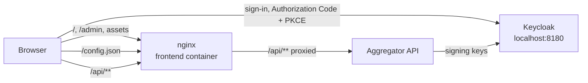

# Dashboard

The browser front end of the aggregator: a public flight search and an admin provider-status screen behind a Keycloak sign-in (spec §6.8). It is a React + TypeScript (strict) single-page app built with Vite, in [`frontend/`](../../frontend/), a standalone npm project outside Gradle. nginx serves the bundle and proxies `/api/` to the aggregator, so the browser sees one origin. Every request and response type is generated from the committed [`openapi.json`](openapi.json), so a contract change breaks the compile. The reasoning behind each choice is in the [design spec](../planning/design-spec.md) (§6.3, §6.5, §6.6, §6.8) and in [plan 6](../planning/plans/2026-11-15-dashboard.md) (Q1 to Q7, and the approved extras E1, E2, E4 and E6 to E9).



## Run it

`docker compose up --build` starts the dashboard with the rest of the stack on `http://localhost:3000` (loopback only), once the aggregator is healthy. The search shows flights once the first ingestion has published (about a minute after the aggregator starts, more on a loaded host; [CI's runs](../planning/progress/2026-11-15-observability-and-delivery.md#final-review--fix-round-frontend-and-docs) took 78 to 86 s). The admin screen is `http://localhost:3000/admin`, where the realm's demo `admin` user signs in. The demo password and the frontend's npm commands are in the README ([Use the dashboard](../../README.md#use-the-dashboard)).

In development, Vite's dev server (`npm run dev`) proxies `/api` to the aggregator on `http://localhost:8080` as nginx does, and `public/config.json` holds the compose values for the sign-in. The realm accepts the redirect back only on `http://localhost:3000/admin`, so the admin screen signs in only when the app is served on port 3000.

## Screens and states

The layout follows Q6, "boarding pass": a top bar, one left-aligned column up to 880 px, flat cards with a 1 px border. The palette is ink `#1B2A41`, cabin `#F5F7FA`, tarmac `#5C6B7A`, beacon `#E8A33D` (Search and Select), cleared `#1E7F4F` and hold `#B3261E`, defined once in `src/styles/tokens.css`; the type is Barlow and Barlow Condensed, self-hosted from `@fontsource` (no font CDN). Every text is English (§6.9).

### Search (`/`, public)

- **Filters:** exactly the brief's four, all optional: "From", "To", "Airline" and "Max price", in one row that stacks under 640 px, and a "Search" button. A "Sort by" radio group: "Price" (the default), "Departure", "Duration". No date or stops filter, no "Best" sort.
- **Airport suggestions:** "From" and "To" share one native `<datalist>` of the dataset's 32 airports, from `src/search/airports.ts` (code → city, the user's decision of 2026-11-16); each option's value is the code and it reads "MAD — Madrid". With a list, the fields' role is `combobox`; their labels are unchanged. On "Search", a From or To text that is exactly a city's name, trimmed and in any case ("madrid", "New York"), is sent as its code; any other text is checked as before. The list must match the aggregator's catalogue (`V2__airport_catalogue.sql`): `src/search/suggestions.test.ts` checks that it, the migration and the README's [Airports in the dataset](../../README.md#airports-in-the-dataset) table hold the same codes.
- **Airline suggestions:** "Airline" has its own native `<datalist>` of the dataset's 12 airlines, from `src/itinerary/carriers.ts`, the names the result cards already show (the user's decision of 2026-11-16); each option's value is the code and it reads "IB — Iberia". On "Search", an Airline text that is exactly an airline's name, trimmed and in any case ("iberia", "air europa"), is sent as its code; any other text is checked as before. Both kinds of suggestion are one mechanism: `src/search/suggestions.ts` names the lists, a field's control in `FilterBar` names the list it suggests, and `codeNamed` turns a name into its code. The list must match `mock-gds`'s `StandardCatalogue`: `src/search/suggestions.test.ts` checks that both hold the same codes and names, and the README's [Airlines in the dataset](../../README.md#airlines-in-the-dataset) table the same codes. The aggregator keeps no airline catalogue, so an unknown airline code is not rejected: it matches no flight.
- **Enter in a field with suggestions:** Chromium and Firefox submit the filters on the first Enter. WebKit gives that Enter to the `<datalist>`, not to the form: in Safari, while the field shows matching suggestions, the first Enter closes them and a second one submits; WebKit on Linux never submits from the field. This is the browser's own handling, left as it is: an app handler that submitted on Enter would run before Safari takes a highlighted suggestion, and send the half-typed text. A WebKit keyboard user submits with "Search", and the keyboard-only end-to-end test does so in WebKit.
- **Decimal comma:** "Max price" accepts a decimal comma (the user's decision of 2026-11-16): an amount with one comma and no dot is read with a dot (`55,5` is `55.5`), in the URL and the request; more than one comma, or a comma with a dot (`1.234,5`), is left as typed and gets the field's usual error (G2, 2026-11-16).
- **A result card** (`ItineraryCard`) reads like a boarding pass: departure and arrival times large on a route line with a dot per stop, the IATA codes, a "+1 day" when the arrival is a later local day (E1; "+2 days" two days later; the words are the user's of 2026-11-16, from a component, `DayMark`, that the legs share); then the departure date ("Fri 20 Nov"), the duration ("7h 25m"), "Direct" or "1 stop: LHR, 1h 10m", each leg's airline and flight ("Iberia IB 3166", E2: the names are a static map of the dataset's twelve carriers in `src/itinerary/carriers.ts`; an unknown code shows alone), and "Multiple airlines" when more than one carrier flies the legs. The stub on the right holds the price with the markup ("€412.60") and its freshness ("Updated 4 min ago", re-rendered every minute). The provider and the legs' prices are never shown.
- **Times** are the wall clock written in each ISO-8601 string, at its own airport (§4.2), never converted to the browser's zone. **Prices** are the API's decimal strings, formatted for display only (`en-GB`, EUR); the browser does no price arithmetic.

| State | What the page shows |
|---|---|
| Loading | "Loading flights…" in a status region; the results section is `aria-busy` |
| Results | "Showing N flights" in a status region, then the cards (20 a page) |
| Load more | "Load more" while the API gives a `nextCursor`; "Loading…" on the button while the next page loads. When the page arrives, the focus moves to the first new card's summary, so a keyboard user carries on where the new results start (G2); a page that adds no card leaves the focus where it was. A failed "Load more" is shown in its place, at the bottom of the list, with the sentences below |
| Results updated | A "Load more" page flagged `inventoryChanged` is appended without the itineraries already shown, and "Results updated." with "Reload" appears in a polite live region; "Reload" reads that search's first page again (Q4-A), and no other cached search |
| Empty | "No flights match these filters. Remove a filter or raise the maximum price." |
| Field error | A value the API would reject (an airport not of three letters, an airline not of two characters, an amount not above 0 with at most two decimals) is shown under its field, with `aria-invalid` and `aria-describedby`, and no request is sent; a shared URL with bad values shows the same errors |
| 400 | The API's `detail` |
| 429 | "Too many searches from your connection. Try again in N seconds.", N from `Retry-After` (seconds or an HTTP date); neither "Try again" nor "Load more" is offered during the wait. Once it is over, a failed "Load more" gives way to "Load more" again, keeping the pages already loaded; a failed first page is asked again by "Search" with the same filters |
| Any other failure | "Flights could not be loaded. Search again in a moment." with "Try again" (E9), which repeats the request that failed and is disabled while it runs |

### Re-price (inside a card)

A card's summary is one disclosure button (`aria-expanded`). Opening it shows each leg (flight, airports, local times, and "+1 day" after an arrival on a later local date than that leg's departure, styled as on the summary, G2) and re-prices the itinerary once per opening (`POST /api/itineraries/{id}/reprice`); closing and opening it again asks again. The answer appears in a status region below the legs:

| Answer | What the card shows |
|---|---|
| Pending | "Checking the price…" |
| `CONFIRMED` | "Price confirmed: €412.60" and "Select"; a price other than the one the stub showed when the card was opened is worded "Price changed: was €412.60, now €431.00" (below) |
| `PRICE_CHANGED` | "Price changed: was €412.60, now €431.00" and "Select", where "was" is the price the stub showed when the card was opened; a new price equal to that one reads "Price confirmed: €412.60" (below). The card's stub shows the new price and its freshness |
| `ALTERNATIVE` | §6.5's notice, *"We couldn't confirm this flight. This is the best alternative we found."*, the alternative's legs under the caption "Alternative legs" (G2: the caption names the list, so its legs are not read as the chosen ones above; G3: a leg that leaves on another local date than the chosen itinerary shows that date before its time, "MAD Sat 21 Nov 08:15", the same day times only), "Price confirmed: €…" and "Select", inside the same card (Q5-A) |
| `503` | §6.5's *"We can't confirm the price right now. Please try again in a few minutes."* (a 502 or a network error says the same) |
| `404` | "This flight is no longer available. Search again for current flights." |
| `429` | "Too many price checks from your connection. Try again in N seconds." |

"Select" goes no further, since booking is out of scope (§6.8); pressed, it says "Booking is not part of this demo." (E8).

The stub always shows one quote of the itinerary with the time it was quoted: the search's, or the last re-price that confirmed or changed it, unless the search's is newer (a "Reload" after it). A reopened card keeps that quote while "Checking the price…" runs; an alternative is another itinerary and leaves the stub as it was.

The API decides `CONFIRMED` or `PRICE_CHANGED` against the price it has stored, which a cached search page (up to 5 minutes) may not show yet: after another customer's re-price changed it, the API confirms the new price, or reports a change from a price this card never showed. So the card words a `CONFIRMED` or `PRICE_CHANGED` answer against the price its stub showed when it was opened: a different price reads as a change from that one, the same price as confirmed, and the API's `previousPrice` is not shown (final review, code I2; the user's decision of 2026-11-16, option A).

### Provider status (`/admin`, admin only)

- "Provider status", then "Loading status…" until the first status arrives, then the inventory's "Generation N", "Published 12 min ago" and "Next ingestion in 18 min" ("Next ingestion in 1 h 30 min" or "Next ingestion in 2 h" from an hour on, or "Next ingestion due"); with no run ended yet, "No ingestion has run yet.".
- **A run in progress:** while a run is going on, scheduled or on demand, on any instance, the API's `ingestionRunning` is true (the run holds the ingestion's ShedLock lock: `IngestionLock`, read by `JdbcIngestionLock` from the lock's row with the database's clock), and the screen says "Ingestion in progress" in place of the next ingestion's line, or "First ingestion in progress." in place of "No ingestion has run yet." while the first run goes on (G2; the user's words of 2026-11-16). The 10 s refresh shows it start and end. A run whose instance died holds the lock for up to 29 minutes, and shows in progress that long, as "Run ingestion now" is refused that long.
- A table captioned "Providers", one row per provider: Provider, Health ("Up", "Degraded", "Down"; colour repeats the word, never replaces it), Circuit breaker ("Closed", "Open", "Half-open"), Last successful ingestion (relative, or "Never"), Legs, and Discarded records (the total, then each reason, "Unknown airport: 3"). A provider whose legs are kept from an earlier run says "Kept from the last good ingestion".
- **"Run ingestion now"** starts a run (`202`: "Ingestion started." and the status read again); while a run is going on, scheduled or on demand, the API answers `409` and the screen shows its detail, "An ingestion is already running." (the ingestion's lock is released when the run ends, plan 5). The status is read every 10 s while the tab is visible, so a started run is seen ending. A failed read says "Provider status could not be loaded. Retrying every 10 seconds."; an account without the `ADMIN` role, "This account does not have the admin role.", after which the status is not read again (the role does not come by asking; G2); an API that refuses the session even after renewing it, "The API refused your session. Sign out and try again." (below). Under 640 px the providers table takes tighter cells, so the screen fits a 390 px phone.
- "Signing in…" while the page goes to Keycloak or comes back; "Sign-in failed. Reload the page to try again." when the settings or the sign-in fail (the cause, such as a missing setting, goes to the browser's console); "Sign out" (E4) ends Keycloak's session too, which sends the browser back to `/admin` and so to the login page.

## The URL holds the search

The query string is the search's only state (§6.8), so a search can be shared or bookmarked and the back button works. `src/search/searchParams.ts` reads and writes it:

| Parameter | Values | Default |
|---|---|---|
| `origin`, `destination` | an airport's IATA code, three letters (any case; upper-cased) | none |
| `carrier` | an airline's IATA code, two letters or digits (any case; upper-cased) | none |
| `maxPrice` | euros above 0, at most nine digits and two decimals (`150`, `149.99`; one decimal comma and no dot, `149,99`, reads as `149.99`) | none |
| `sort` | `price`, `departure` or `duration`; anything else is `price` | `price` (left out of the URL) |

Values are trimmed, empty ones are left out, and other parameters are ignored. Submitting a search or changing the sort pushes a history entry. The search sends no `limit` (the API's default 20) and `cursor` only on "Load more"; nothing of the pagination is in the URL.

## Server state

TanStack Query holds every server answer; there is no global state manager.

- **Search:** an infinite query keyed by the criteria (`useItinerarySearch`), one page per "Load more", disabled while a field has an error. Loaded pages are never refetched by themselves (`staleTime: Infinity`), and a failed search is not refetched when the window regains focus or the connection comes back, since each refetch would spend the rate limit; "Reload" and "Try again" are explicit, and the hook's `useSearchResets` owns both resets of one search (`exact` keys). A request whose search the customer has left (new filters or sort) is aborted through TanStack's `signal`. Searching for the search already shown adds no history entry. `mergePages` keeps the first occurrence of each itinerary id across pages and flags the list when any page is flagged.
- **Retries:** a query retries (TanStack's three times) only a network error or a `5xx` without `Retry-After`; a `4xx`, a `429` above all, answers at once and is not repeated, and so does a `5xx` with `Retry-After` (a `503` with `Retry-After: 60` would not pass sooner; G2). Mutations never retry.
- **Re-price:** one mutation per card (`useReprice`). **Status:** a query refetched every 10 s (`useInventoryStatus`), until it answers `403`; "Run ingestion now" is a mutation that invalidates it.
- **Errors:** the `openapi-fetch` client's `apiErrors` middleware turns every non-2xx answer into an `ApiError` with the status, the RFC 9457 `detail` when the body is a problem (any case of the media type), and `Retry-After` in seconds (sent as seconds or as an HTTP date); any other body (nginx's HTML 502), or a problem body that is not valid JSON, leaves the detail empty. Screens read only the status, the detail and the seconds. A 2xx without a body, which the contract never sends, fails through one helper, `bodyOf`.

## Types from the contract

`src/api/schema.d.ts` is generated from `docs/architecture/openapi.json` by `npm run api:generate` (`openapi-typescript`, its output left as generated: Prettier ignores the file) and committed; `src/api/types.ts` names its schemas as the dashboard uses them. `npm run api:check` (`openapi-typescript --check`, G3) regenerates in memory and fails with "Generated types are not up-to-date!" when the committed file differs, or with `ENOENT` when it is missing; CI's "Contract drift" step runs it, and its name says the fix, `npm run api:generate`. On the backend side, `OpenApiContractTest` fails when the served contract drifts from the committed file, so the two halves together catch any drift (§6.11 step 3). A change to `openapi.json` regenerates the types in the same commit (`CLAUDE.md`).

## Sign-in and the admin's token

The admin screen signs in with standard OIDC through `oidc-client-ts`, so Keycloak can be swapped for another provider by configuration (§6.6, Q2-A):

1. `/admin` reads `/config.json` (below) once per page, then creates the `UserManager` (`createAuthClient`). A later read, on focus or reconnect, would replace a signed-in screen if it failed, so there is none.
2. With no session, the page goes to Keycloak's login with Authorization Code and PKCE `S256`, `scope=openid`, and `redirect_uri` `http://localhost:3000/admin`.
3. Keycloak sends the browser back to `/admin?code=…&state=…`; `AdminSession` exchanges the code, replaces the URL with `/admin` (the answer is spent either way), and shows the status.

The realm's client `dashboard` ([`deploy/keycloak/flight-aggregator-realm.json`](../../deploy/keycloak/flight-aggregator-realm.json)) is public (a browser cannot keep a secret), standard flow only, PKCE `S256` required, no password grant; its redirect is `http://localhost:3000/admin*`, its web origin `http://localhost:3000` and its post-logout redirect `http://localhost:3000/admin`. Machines keep the confidential `admin-service` client of the README.

**Tokens stay in memory** (`InMemoryWebStorage`), where no other script can read them; only the PKCE verifier sits in `localStorage` for the trip to Keycloak (the library's default). A reload passes back through Keycloak's own session without the password. **Only admin calls carry the token:** `api`, the public client, never sends one; `adminClient(auth)` adds `Authorization: Bearer` to `/api/admin/**`. **Renewal:** Keycloak's access token lasts 5 minutes, and the status page polls longer than that. On a `401`, the admin client renews the session once (`signinSilent`) and repeats the call once with the new token. Calls that answer `401` while a renewal runs share it and its outcome (G3): one `signinSilent`, and at most one sign-in, however many calls the expired token failed. A refused renewal of an expired token means Keycloak's session ended: the browser goes to the sign-in. A token that has not expired, refused with no renewal possible (a client with refresh tokens turned off), would come back from a new sign-in just as refused, so its `401` reaches the screen too. A renewed token refused too means the API does not accept this issuer's tokens (a wrong issuer or signing keys, a clock ahead); a new sign-in would get the same kind of token without asking for anything and loop, so the `401` reaches the screen instead, which says "The API refused your session. Sign out and try again." with "Sign out" beside it (the user's decision of 2026-11-16). The status keeps its 10 s refresh, each one renewing once more.

## `/config.json`

One image serves every environment (Q3-A): the sign-in settings are not baked into the bundle. nginx answers `/config.json` from the container's environment:

```json
{"oidcAuthority":"${OIDC_AUTHORITY}","oidcClientId":"${OIDC_CLIENT_ID}"}
```

Compose sets `OIDC_AUTHORITY=http://localhost:8180/realms/flight-aggregator` (the address a browser reaches Keycloak by, which is also the tokens' issuer) and `OIDC_CLIENT_ID=dashboard`. Only the admin screen reads it; an unreadable file or a missing or empty field stops the sign-in, and the screen says "Sign-in failed. Reload the page to try again.". `public/config.json` holds the same values for `npm run dev`.

## nginx

`frontend/Dockerfile` builds the bundle in a `node` stage (`npm ci`, `npm run build`; the tests run in CI, not in the image) and serves it from the `nginx` stable image, both pinned by tag and multi-arch digest (§6.1). nginx runs as the unprivileged `nginx` user on port 8080; compose publishes it on `127.0.0.1:3000` and checks its health with `wget --spider`. The template `frontend/nginx/default.conf.template` is rendered at container start by the image's entrypoint:

- **`/api/`** is proxied to `API_UPSTREAM` (`http://app:8080` in compose). The upstream is a variable resolved per request through the container's own nameservers (`resolver ${NGINX_LOCAL_RESOLVERS} valid=10s`, from `/etc/resolv.conf` by the image's `15-local-resolvers.envsh`: Docker's embedded DNS in compose, the cluster's DNS elsewhere), so a recreated `app` container is found without restarting nginx. nginx's resolver ignores the `search` domains of `/etc/resolv.conf`, so outside Docker, whose embedded DNS answers service names itself, `API_UPSTREAM` must name a fully qualified host (on Kubernetes `http://app.<namespace>.svc.cluster.local:8080`, not `http://app:8080`); a short name does not resolve there, and every `/api/` call answers `502`. `X-Forwarded-For` is **overwritten** with the connection's address, never appended, because the API's rate limit counts the client address that its `RemoteIpValve` reads from that header: a client must not choose its own counter (plan 5's client-IP decision). For the same reason a client's `X-Forwarded-Proto`, `X-Forwarded-Host` and `X-Forwarded-Port` are not passed on. An app that accepts the call and never answers gets a `504` after 20 s (`proxy_read_timeout`), above the slowest re-price: its 10 s budget plus a quote already in flight, up to three attempts of 2.5 s with 0.6 s of backoff between them, about 18.1 s in all ([search API](search-api.md)).
- **Behind a load balancer** (any deployment with a TLS terminator in front), `$remote_addr` is the balancer's address, so every customer would share one rate-limit counter. There nginx must first trust the balancer's range with the realip module (`set_real_ip_from <range>; real_ip_header X-Forwarded-For;`), so that `$remote_addr` is the customer again. Compose has no balancer.
- **`/config.json`**, above.
- **`/assets/`**, the bundle's hashed files: a missing one is a `404`, not `index.html` (an `index.html` cached from before a redeploy then fails cleanly).
- **Everything else** is a file or `index.html` (`try_files $uri /index.html`), so `/admin` and shared search URLs survive a reload.

Because the template pastes the three values raw into a `set` directive and a JSON string, `nginx/10-validate-config.sh` runs first and stops the container, naming the variable, when one is missing or not valid: `API_UPSTREAM` must be `http(s)://`, a host and an optional port, with no path (through a variable, a path in `proxy_pass`, even a trailing `/`, would replace every request's URI); `OIDC_AUTHORITY` a plain `http(s)` URL; the client id letters, digits, dots, underscores and hyphens. A quote, a backslash, `$`, a space, a semicolon or a line break would break them. nginx runs unprivileged, so the image drops the `user` directive it would warn about. nginx adds no security or caching headers (E5 was rejected).

## How each layer is tested

| Layer | Tool | What it proves | Where it runs |
|---|---|---|---|
| Types and gates | `tsc -b` (strict), ESLint with `typescript-eslint` and `jsx-a11y` (E7), Prettier | The code compiles strictly against the generated types, and lints and formats clean | `npm run verify`; CI job `frontend` |
| Contract | `openapi-typescript --check` (`npm run api:check`) | The committed types are what the committed contract generates | `npm run verify`; CI job `frontend`, step "Contract drift" |
| Airport and airline lists | `src/search/suggestions.test.ts` (Vitest in Node, reading the files) | The dashboard's airports, `V2__airport_catalogue.sql` and the README's table hold the same 32 codes; the dashboard's airlines and `StandardCatalogue` the same 12 codes and names, and the README's table the same codes | `npm run verify`; CI job `frontend` |
| Units and components | Vitest, React Testing Library, MSW (jsdom; an unhandled request fails the test), `vitest-axe` (E7) | Each component and hook against mocked API answers: URL parsing and validation, local times in another zone, layovers, freshness, every search and re-price state, no retry on a 4xx or on a 5xx with `Retry-After`, "Load more" without duplicates and the focus on its first new card, the sign-in and its single renewal on a `401`, the status page, its 10 s refresh and its end on a `403`; axe checks on the rendered components (colour contrast needs a real browser, so it is left to the end-to-end tests) | `npm run verify`; CI job `frontend` |
| Image | `frontend/nginx/test-config-validation.sh` | The image refuses an unsafe setting (an upstream with a path included), naming it, and serves a good one; resolves through the container's nameserver; the client's forwarded scheme, host and port do not reach the app; a missing asset is a `404`; nginx starts without a warning; a hung app answers `504` after 20 s | CI job `images` |
| End to end | Playwright with `@axe-core/playwright`, against the whole compose stack through nginx | Smoke (the page, `/admin` on reload, the proxy, `/config.json`); search (cheapest first and 20 more, the origin filter kept in the URL across reload and back, both sorts, the filters stacked at 390 px); re-price (an opened card's confirmed, changed or alternative price); accessibility (no axe violation of WCAG 2.1 A and AA, colour contrast included, on results, an opened card, the empty state and a field error; search, "Load more" and a card by keyboard only); admin (the Keycloak sign-in, three providers, the table within a 390 px phone, a run on demand that publishes a new generation); the rate limit (a forged `X-Forwarded-For` is still counted under the client's own address) | `npm run e2e`; CI job `e2e` |

The end-to-end specs (`frontend/e2e/`) run with one worker, no retries and the real rate limits. Each browser, Chromium, Firefox and WebKit (E6), runs smoke, search, re-price, accessibility and admin before the next browser starts, so three browsers' searches do not crowd one minute's limit; then the observability checks run once, in Chromium ([Observability](observability.md#how-each-part-is-tested)), and the rate-limit test runs once, last. A global setup polls the search every 5 s, up to 180 s, until the first ingestion has published. The specs never name a route or a price of the rolling dataset: they read times from `<time dateTime>`, and prices and codes from the page.

**Running the end-to-end tests:** start the stack (`docker compose up --build -d --wait`), then in `frontend/` `npm ci`, `npx playwright install --with-deps chromium firefox webkit` and `npm run e2e`. CI runs exactly that on Ubuntu (job `e2e`). On macOS 27, Playwright 1.64.1's Firefox does not start (`Could not find profile folder.`), so `npm run e2e` stops at the first Firefox project there; run the suite in Playwright's Linux image instead, against the same stack, from a copy of `frontend/` without `node_modules` (the image installs Linux binaries, which must not land in the working copy). From the repository root, with the stack up (`--network host` lets the container reach the stack's `localhost` ports, as the specs expect):

```bash
copy=$(mktemp -d) && rsync -a --exclude node_modules frontend/ "$copy/"
docker run --rm --network host --ipc=host -v "$copy:/work" -w /work \
  mcr.microsoft.com/playwright:v1.64.1-noble bash -c "npm ci && npx playwright test"
```

On 2026-11-16, after plan 6's closing round, this ran 34 tests green in 3.1 minutes on a stack just started (the run is recorded in the [plan 6 progress report](../planning/progress/2026-11-15-dashboard.md)).

## Known limitations

Accepted by the user on 2026-11-16 (plan 6's end-of-plan review):

- **A failed sign-out is silent.** When "Sign out" cannot reach Keycloak, the admin screen stays as it was and says nothing (code review M4).
- **Keycloak down when a token must be renewed.** The renewal fails, so the admin client sends the browser to Keycloak's sign-in, and the tab shows the browser's own error page instead of a message on the screen (risk review M-2).
