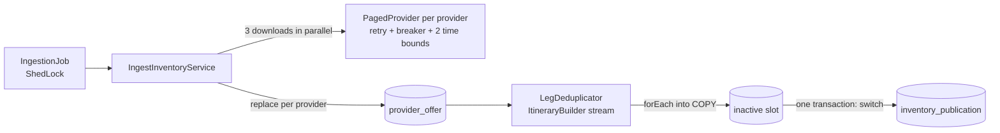

# Ingestion

The ingestion downloads the three providers, keeps each provider's offers whole, builds every itinerary and publishes them into PostgreSQL in one atomic switch. It runs in the `bootstrap` application (`IngestionJob`, `IngestInventoryService`) and is measured by the run described at the end. The reasoning behind each choice is in the [design spec](../planning/design-spec.md) (§4.3, §6.1 to §6.5, §6.10).

## The run

1. **Downloads, in parallel.** One virtual thread per provider. Each provider is one `PagedProvider`, built from its endpoint, which names the provider once; it is called page by page in its own format (`AlphaPage` by cursor, `BetaPage` by page number, `GammaPage` by offset), 1000 records per page, at most 200 pages and 8 MiB per body. A page with more records than it was asked for fails the download (`MALFORMED_PAGE`). Two time bounds apply: a request is cut at 2.5 s (`providers.request-timeout`) and the whole download of one provider at 60 s (`providers.download-timeout`).
2. **Retry and breaker.** A transient failure (a 5xx, a timeout, an I/O error) is retried up to 3 attempts in all, waiting 200 ms and then 400 ms; each retry is counted. Each attempt goes through the provider's circuit breaker: over its last 10 calls it opens at 50% failures, stays open 60 s, then lets 3 trial calls through. A refused key (`401` or `403`), another client error, a redirect or an oversized body is not transient: it is not retried and the breaker ignores it.
3. **Whole or nothing, per provider.** A provider's offers replace its stored ones (`provider_offer`) only when its whole download succeeded, in one transaction. If any page fails after the retries, none of that run's pages is stored and the previous offers stay (status `KEPT`, with the `FailureReason`: `HTTP_ERROR`, `TIMEOUT`, `UNAUTHORIZED`, `CIRCUIT_OPEN`, `MALFORMED_PAGE`, `PAGINATION_LIMIT`, `EMPTY_DOWNLOAD` or `UNEXPECTED`). A malformed record is not a failed download: it is discarded with its reason (`DiscardReason`), logged and counted, and the rest of the page is used.
4. **A download with no usable leg.** A download that arrives whole but leaves no leg once its records are parsed and checked against the airport catalogue (an empty list, or every record discarded) is a failed download too: the provider is `KEPT` with `EMPTY_DOWNLOAD`, its stored offers are untouched, its discarded records are still logged and counted, and it gets the same `WARN` line and count as any kept provider (§6.5: good data is never replaced by nothing). There is no rule on the share of records dropped.
5. **Itineraries.** The stored offers of all three providers are deduplicated into one leg per flight, and `ItineraryBuilder` returns a lazy stream of every itinerary of one to three legs. The stream is consumed only with `forEach`, straight into `COPY` (push mode, R4), so the roughly one million itineraries are never held in memory. A provider that gives one flight two arrivals contradicts itself: all its offers of that flight take no part. They are reported as `CONFLICTING` discarded records, and counted, only by the run that downloaded them (the provider is `FRESH`); a kept provider's old conflicts are not reported again on every run that keeps them.

## One origin, one flight, and the limit per provider

Besides the whole download, each `PagedProvider` offers two more calls, for the search API (plan 5). Both use the mock's "Origin filter and quote" parameters ([Mock providers](README.md#origin-filter-and-quote)):

- `downloadFrom(origin)` downloads one origin's legs, with the same pages, bounds and failures as the whole download.
- `quote(flight)` asks for one flight. It is one request through the same HTTP client (breaker, retries, request timeout), at most one record on one page, and it is quoted at the response's arrival. The listing's empty page means the flight is no longer sold. A record of another flight, a discarded record or a second record fails the quote with `MALFORMED_PAGE`.

The three calls of one provider share one limit, `providers.concurrency-limit` calls at once (4, Q9), set in `application.yaml`; startup stops without it. The limit is Spring's `@ConcurrencyLimit` on the `PagedProvider` class with the `REJECT` policy: a call over it fails at once with `InvocationRejectedException`, a `RejectedExecutionException`, and is never queued. `provider()` and `toString()` are exempt. Each provider bean is proxied on its own, so each provider has its own limit. The proxy is a class proxy (Boot's default), so `PagedProvider` is not `final`. An interface proxy would read the exemptions from `FlightProvider`'s methods and so would limit `provider()`.

Every call of a provider is counted, as `provider.calls`, by `CountedFlightProvider`, which wraps the limited provider (`CountedProviders`, after the proxy), so a rejected call is counted too.

## The slots

Search will read `itinerary_a` or `itinerary_b`, whichever `inventory_publication.active_slot` names (double buffering, §6.5). A run writes the other one, in a single transaction (`JdbcItineraryRepository.replaceInventory`):

1. `SET LOCAL statement_timeout = '5min'`, so a statement that hangs fails the run (the `COPY` of every itinerary takes about 12 s), and `SET LOCAL lock_timeout = '60s'` for the next step only; every later lock waits 5 s at most, so a run fails rather than waiting for ever on a lock.
2. `SELECT active_slot FROM inventory_publication FOR UPDATE`: the publication row stays locked until the run commits or rolls back. A second run at the same moment waits here, before it touches either slot, and fails after 60 s; it can never read the old active slot and truncate the new one after the first run's switch. A stale-route refresh holds the same row while it rewrites an origin's itineraries, which takes seconds, so a run that starts meanwhile waits for it here rather than failing at 5 s (Q9). A re-price's update in place (`updateInPlace`, one row of the active slot deleted and copied back) takes the same row `FOR SHARE NOWAIT`, with the same two timeouts: re-prices share the row, so they store side by side, and a run that starts meanwhile waits here for them. While a run holds the row, an update does not wait: it stores nothing, and the re-price still answers its live price; `reprice.store{outcome}` counts every update as `STORED`, `GONE` or `BUSY`, and each `BUSY` one is also a `WARN` line naming the itinerary.
3. `TRUNCATE` the inactive slot, then drop its day partitions before today.
4. Create the day partitions from today to today plus 37 (`CREATE TABLE IF NOT EXISTS ... PARTITION OF`). A slot is `PARTITION BY RANGE (departure)` with one partition per UTC day, defined once in `PartitionCalendar`, and a `DEFAULT` partition for any departure beyond them (§4.3). The truncate comes first because PostgreSQL refuses to create a partition while the default one holds rows in its range.
5. `COPY` the itineraries in, as they are built.
6. `ANALYZE` the slot (the parent, which samples every partition), so search never reads it without statistics.
7. `UPDATE inventory_publication` to the new slot, with `generation + 1`. The `Publication` it returns states `partitionedUntil`, the instant the last day partition ends.

Each slot carries six sort indexes (migration V5, Q6-B): the three sort orders, price, departure and duration, each keyed by `id` as the tie-breaker, alone and behind an `origin, destination` prefix. They are created on the partitioned parent, so every day partition, present or created by a run, and the `DEFAULT` partition have them.

Search keeps reading the old slot until the transaction commits, then reads the new one. Any failure rolls the whole transaction back, so the published slot is never touched by a failed run. A provider's offer replacement is bounded the same way (`statement_timeout` 5 min). Every connection reads with a 120 s socket timeout and TCP keepalive on (`spring.datasource.hikari.data-source-properties` in `application.yaml`, whatever the URL), so a database that stops answering fails a run instead of blocking it.

Two outcomes publish nothing and leave the previous generation active:

- **`NOTHING_TO_PUBLISH`**: no provider has stored offers, or no itinerary can be built from them (an empty generation is never published).
- **`CEILING_EXCEEDED`**: the run would build more than `ingestion.max-itineraries` (2,000,000), so the writer throws and the transaction rolls back (R7).

## The stale-route refresh

A search from an origin whose last publication or refresh is more than 10 minutes old asks for that origin's refresh, once per claim (§6.4, §6.2). `BackgroundRefresh` runs it on a virtual thread of its own and returns at once, so the search neither waits for it nor fails with it. `RefreshStaleRouteService` then works as follows (plan 5, Q2-B):

1. **Downloads the origin from every provider at once** (`downloadFrom`), each download checked as a run checks its own: `ProviderDownloads` is shared by both. A provider whose download fails, is rejected by its concurrency limit, or leaves no usable leg (`EMPTY_DOWNLOAD`) is `KEPT`; one whose download arrived whole is `FRESH`.
2. **Swaps, in memory only, each fresh provider's stored offers from the origin** for the ones it has just downloaded. A kept provider's offers stay. `provider_offer` is not written: the next run downloads everything again.
3. **Deduplicates and builds as a run does,** with the refresh's start as `now`. The conflicting offers of the origin's fresh downloads are reported as `CONFLICTING`, as a run reports its own.
4. **Rewrites the itineraries with a leg departing from the origin** (`JdbcItineraryRepository.replaceThrough`), in one transaction on the active slot:
   - the timeouts of every store (5 s per lock, 5 min per statement);
   - the publication row `FOR UPDATE`, so a run cannot switch slots meanwhile, and a re-price answers `BUSY` until the refresh commits;
   - `DELETE` of every row whose `legs` contain a leg from the origin (`legs @> '[{"origin": "MAD"}]'`, a scan of the active slot, with no index);
   - `COPY` of the built itineraries through the load's own `ItineraryRow`;
   - `generation + 1`, with `published_at` unchanged: it stays the last run's.

   Search reads the old rows or the new ones, never a mix, and a failure anywhere rolls the whole rewrite back. The new generation invalidates every cached page and flags every cursor, as a run's does. The deleted rows are left for autovacuum.
5. **Marks the origin refreshed** in Valkey, at the refresh's start, once the rewrite has committed.

When no provider's download is fresh, nothing is written and the origin is not marked, so a later search asks again once the claim expires (2 minutes). Each refresh logs one line as ECS JSON, `The refresh of a stale origin ended`, at `INFO`. It holds `origin`, `outcome` (`REFRESHED` or `NOTHING_FRESH`), `generation`, `itineraries` (the rows rewritten; both 0 when nothing was written) and each provider's `status`. A refresh that throws, the rewrite's lock timeout included, is one `ERROR` line with its `origin` and stack trace. Every line of one refresh carries its own `correlation.id`. Its provider calls are counted under `provider.calls{operation=origin-download}`, and its discarded records under `ingestion.records.discarded`, as a run's are.

## Schedule and lock

`IngestionJob` runs at startup and then 30 minutes after each run ends (`ingestion.interval`, fixed delay). It takes the ShedLock row `ingestion` (table `shedlock`, at most 29 minutes, at least 1 minute) so that one instance at a time runs; a run that does not get it, on this instance or another, logs `Skipped an ingestion run: another run holds its lock` at `INFO` and returns at once. A skipped run is neither counted as a success nor as a failure.

An admin can also start a run now (`POST /api/admin/ingestions`): `IngestionJob.launch` runs the same body on a virtual thread of its own, under the same lock, and answers once the run holds it, or at once when another run does (the endpoint's `409`). Every run that ends with a report, published or not, records each provider's status in `ingestion_status` (V7) for `GET /api/admin/status`; a failure to record it is a `WARN` line and never fails the run.

What is caught, exactly:

- **In a provider's download:** a `ProviderUnavailableException` (its `FailureReason`) and any other `RuntimeException` (`UNEXPECTED`). That provider is `KEPT`; the run goes on.
- **In the job:** everything else a run throws, taking the lock included (an unreachable database, a failed load). It is logged at `ERROR` with its stack trace and counted as outcome `FAILED`. A runtime exception never escapes, so the next run still comes. An `Error` (out of memory, say), whether thrown in the job's thread or in a download's, is logged and counted the same way, then rethrown to the scheduler.

## When providers are down

A failed provider never empties the inventory: its last good offers are used again, and the run still publishes.

| Down | Result |
|---|---|
| 1 | `PUBLISHED`. The failed provider is `KEPT` with its reason and one `WARN` line; the other two are `FRESH`. |
| 2 | `PUBLISHED` from one fresh provider and two kept ones. |
| 3 | `PUBLISHED` from the three kept sets, if they hold offers; `NOTHING_TO_PUBLISH` if nothing was ever stored (for example the first run after a fresh install). Either way the run counts as failed in `ingestion.consecutive.failures`, because nothing new came in: the alert on failures in a row fires during the outage. Itineraries get no newer, and the quotes' age shows in the metrics. |

## Observability

Each run logs one line, `Ingestion run ended`, as ECS JSON: at `INFO` for `PUBLISHED`, at `WARN` for any other outcome. It holds `outcome`, `generation`, `itineraries`, `duration` and, per provider, `status`, `failure`, `fetched`, `discarded` (by reason), `used` and `lostToDeduplication`. Each kept provider is one `WARN` line with its reason and its failure's stack trace, and each discarded record one `WARN` line with its provider, reason and excerpt (escaped and cut to 200 characters, `ProviderText`).

**Correlation id.** Every line of one run carries the same run id, a random UUID, as `correlation.id` in the logging context (MDC): the job's lines, the kept providers' and the discarded records', which are logged on the job's thread after the downloads. In the JSON it appears nested, `"correlation":{"id":"..."}`. It rides the MDC rather than a Java Scoped Value (spec §6.1): the log framework reads the MDC, and a Scoped Value would not cross the executor's threads without the preview `StructuredTaskScope`. The circuit breakers' transition lines are logged on a download's thread and carry no run id.

Each state transition of a provider's circuit breaker is one `WARN` line, `A provider's circuit breaker changed state`, with `provider`, `from` and `to`.

Metrics use low-cardinality tags only (`provider`, `reason`, `outcome`, `status`, `operation`):

| Meter | Meaning |
|---|---|
| `ingestion.duration{outcome}` | Timer of every run that was not skipped, `FAILED` for one that ended with an exception |
| `ingestion.runs{outcome}` | Runs by outcome, `FAILED` for an exception |
| `ingestion.consecutive.failures` | Runs in a row that failed: published nothing, ended with an exception, or published with no provider `FRESH`. It goes back to 0 only on a run that publishes with at least one fresh provider |
| `ingestion.provider.downloads{provider,status,reason}` | Downloads, `FRESH` or `KEPT`, with the `FailureReason` (`none` when fresh) |
| `ingestion.provider.retries{provider}` | Retries of a provider's requests, not counting the first attempts |
| `provider.calls{provider,operation,outcome}` | Every provider call, ingestion's or not: `operation` is `download`, `origin-download` or `quote`; `outcome` is `OK`, `NOT_SOLD` (a quote of a flight no longer sold), the `FailureReason`, or `REJECTED` (over the provider's concurrency limit) |
| `ingestion.provider.last.fresh.seconds{provider}` | Age of the newest quote among the provider's stored offers, fresh or kept; restored by the first run after a restart, `NaN` while the provider has nothing stored |
| `ingestion.records.discarded{provider,reason}` | Discarded records. `CONFLICTING` counts a fresh download's self-contradicting offers, once, on the run that downloaded them |
| `resilience4j.circuitbreaker.*{name}` | Each provider's breaker (its state, calls and failure rate), named after the provider, by Resilience4j's Micrometer binding |
| `ingestion.itineraries` | Itineraries in the last publication |
| `ingestion.partitions.default.rows` | Rows in the `DEFAULT` partition (should stay 0) |
| `ingestion.partitions.days.ahead` | Whole days from now until the last day partition ends (37 just after a run) |

## Running it

`docker compose up --build` starts the mock providers, PostgreSQL and the aggregator with `-Xmx512m` (`compose.yaml`, `bootstrap/Dockerfile`). Measured: 1,021,205 itineraries published in 12 to 14 s, with the app container at 316 MiB under `-Xmx512m`; the run, with its per-provider numbers, is in the [progress report](../planning/progress/2026-11-15.md#task-11--evidence). The application needs a web server (`spring-boot-starter-webmvc`) to stay alive between runs and to serve `/actuator/health`: without one the JVM exits after the first run. A `providers.*` setting that names no setting stops startup (`ignoreUnknownFields = false`, as in mock-gds); Boot's report of it prints its value, so no secret should sit under a misspelt key.
