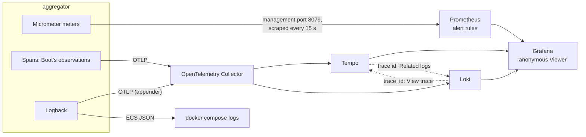

# Observability

How the aggregator's three signals, metrics, traces and logs, leave the application and meet in one Grafana that the whole team opens without signing in (spec [§6.10](../planning/design-spec.md#610-observability-decided-in-the-grill-me-q9), [§6.6](../planning/design-spec.md#66-authentication-and-access-control-decided-in-the-grill-me-q6)). `docker compose up --build` starts every part, configured from files under `deploy/`; nothing is set up by hand. Built by [plan 7](../planning/plans/2026-11-15-observability-and-delivery.md), Tasks 1 to 7 and its extras E1, E4 and E5; the evidence is in its [progress report](../planning/progress/2026-11-15-observability-and-delivery.md).

## The pipeline



| Signal | From the application | Through | Stored in | Read in |
|---|---|---|---|---|
| Metrics | Micrometer, Actuator's `/actuator/prometheus` on the management port | Prometheus's scrape, every 15 s, no token | Prometheus, in memory (tmpfs) | Grafana's dashboard; Prometheus's alerts page |
| Traces | Boot's observations (HTTP server and client, `@Scheduled`, `ingestion.run`, Spring Security, Lettuce), the OpenTelemetry bridge | OTLP over HTTP to the Collector, which forwards to Tempo | Tempo, on its container's disk | Grafana's Explore |
| Logs | Logback: the console's ECS JSON, and OpenTelemetry's Logback appender | OTLP over HTTP to the Collector, which forwards to Loki's OTLP endpoint | Loki, on its container's disk | Grafana's Explore; `docker compose logs app` |

**Telemetry is never in a request's path** (spec §6.5). The app depends on none of these services: an exporter that cannot reach the Collector drops what it holds, and the search and the runs go on at their normal speed (`TelemetryUnavailableTest`). Nothing keeps telemetry across `docker compose down`: no service has a volume (plan 7, Q4).

## Who reaches what

| Service | Address | Who |
|---|---|---|
| Grafana | `http://localhost:3001` | Anyone who reaches it, as an anonymous **Viewer**: the dashboard, the alert list and Explore. The login form and basic authentication are off and no Grafana account is committed, so nobody signs in, not even the built-in administrator (spec §6.6). Explore is open to Viewers through Grafana's `viewers_can_edit`: a Viewer may change a panel on screen but never save it, and the provisioned datasources and dashboard are read-only (plan 7, Q1-A). Explore's query history is off |
| Prometheus | `http://localhost:9090` | Its alerts page and query screen (plan 7, Q4) |
| Management port 8079 | not published | Only compose's network: Prometheus scrapes `/actuator/prometheus` there with no token. The API port, 8080, serves no metrics ([Search API](search-api.md#admin-side-and-health)) |
| Collector, Tempo, Loki | not published | Only compose's network: the app writes to the Collector; Grafana reads Tempo and Loki |

Both published addresses are on the loopback interface only, like every service. The `ADMIN` role keeps the admin actions and the dashboard's provider-status screen; metrics are for the whole team (the user's decision of 2026-11-15). In production Grafana would sit behind the company's sign-in.

## Metrics

The meters, their tags and what each one means are listed once, in [Ingestion](ingestion.md#observability); the search adds `search.cache{result}` (hit, miss or error, [Search API](search-api.md)), and Boot and its libraries add the HTTP, JVM, Hikari, Spring Security and Valkey circuit-breaker meters. Prometheus stores them under Micrometer's Prometheus names:

- every dot becomes an underscore: `ingestion.consecutive.failures` is `ingestion_consecutive_failures`;
- a counter ends in `_total`: `provider_calls_total`, `ingestion_runs_total`, `ingestion_records_discarded_total`, `search_cache_total`;
- a timer is `_seconds_count`, `_seconds_sum` and `_seconds_max`, with no buckets: `ingestion_duration_seconds_max`;
- every series also has Prometheus's `job="app"` and an `instance` per replica, which compose's DNS lists for the scrape.

The full list of names Prometheus stored on a real run is in [Task 2's evidence](../planning/progress/2026-11-15-observability-and-delivery.md#task-2--evidence), under "The run"; the dashboard's test reads its names from that list (`StoredMetrics`). Tags are low-cardinality only: never an origin, destination, carrier, itinerary, user or client address (spec §6.10).

## Alert rules

Prometheus evaluates `deploy/prometheus/rules/ingestion.rules.yaml` every 15 s. There is no notification channel and no Alertmanager (spec §6.10): the alerts are read on Prometheus's alerts page and in Grafana's alert list.

| Alert | Fires when | At once or after |
|---|---|---|
| `IngestionFailing` | `max(ingestion_consecutive_failures) >= 3`: three failed runs in a row, 90 minutes at the 30-minute cadence (spec §6.5) | at once |
| `PartitionHorizonShort` | `max(ingestion_partitions_days_ahead) < 34`: three days of runs missed; 37 just after a run (spec §4.3) | at once |
| `RowsInDefaultPartition` | `max(ingestion_partitions_default_rows) > 0`: a departure day with no partition (spec §4.3) | at once |
| `ProviderDataStale` | `min by (provider) (ingestion_provider_last_fresh_seconds) > 5400`: a provider's newest data older than three cadences (plan 7, Q3-A) | at once |
| each of them but `RowsInDefaultPartition`, with the label `gauge: unknown` | the gauge reads `NaN` on every instance, or no instance reports it | after 15 minutes |

What the rules mean when an instance is restarted, down, or one of several (the plan 4 close-out, binding):

- **Several instances** are combined: the maximum of the failures in a row and of the partition gauges, the minimum of a provider's data age. A `NaN` on one instance is skipped while another holds a number, so a restarted instance beside a healthy one changes nothing.
- **`NaN` or missing counts as stale.** A gauge reads `NaN` before an instance's first run (and a provider's age while it has nothing stored); it is missing when no instance is scraped. Either fires its rule's `gauge: unknown` variant after 15 minutes on every instance: a normal restart reads `NaN` for well under a minute, while a crashed run's lock, which keeps a restarted instance from running for up to 29 minutes, does fire. An unknown `DEFAULT` row count is `PartitionHorizonShort`'s, since both gauges read the same publication.
- **No `for` on a value:** each condition already spans several runs or days (Q4). The 15-minute wait applies only to an unknown gauge, so a Prometheus that has just started does not fire before its first scrape.

## The dashboard

One dashboard, "Flight aggregator" (uid `flight-aggregator`), provisioned from `deploy/grafana/dashboards/flight-aggregator.json` by a read-only file provider. Its first seven panels are the metrics the spec promises (plan 7 Task 6); the last three are approved extras (E4, E5). The metric panels read Prometheus and combine instances as the rules do; the alert list reads Prometheus's rules, and the logs panel reads Loki:

| Panel | Shows |
|---|---|
| Provider calls | calls per second by provider and outcome |
| Circuit breakers | each provider's breaker state, coloured |
| Data freshness | each provider's data age (minimum over instances), red from 5,400 s |
| Ingestion | runs in the last hour by outcome; run duration against the 30-minute cadence; failed runs in a row |
| Cache hit ratio | hits over all lookups of the search cache in the last hour, errors included |
| Discarded records | records discarded in the last hour, by provider and reason |
| Partitions | days ahead, red below 34; rows in `DEFAULT`, red from 1 |
| HTTP requests | the search's and the re-price's requests per second by outcome, client errors orange and server errors red; their mean and maximum latency, dashed, on the right axis (Spring's `http.server.requests`; admin calls and health checks left out) |
| Alerts | Prometheus's rules and their state, healthy ones as Normal: each alert's rule on its value and its `gauge: unknown` rule, as on Prometheus's alerts page |
| Logs | the application's lines from Loki, newest first; a line's details hold **View trace** |

The gauge tiles (freshness, partitions) are instant queries: a gauge that reads `NaN` or is missing shows "unknown" in the colour of the alert that fires on it, never its last healthy value. Counters created on their first use (`ingestion.runs`, `ingestion.records.discarded`) are counted in full the first hour they exist, so the startup run shows; `provider.calls` uses `rate`, which misses a counter's first increment, so the startup run's calls show from the second run on.

## Traces

One search, re-price, refresh or ingestion run is one trace (spec §6.10), with W3C `traceparent`:

- **Every request and run is sampled** (`management.tracing.sampling.probability: 1.0`, plan 7 Q4; Boot's default is 10%). The sampler is parent-based, so a caller's `traceparent` decides for the requests it sends: a caller that sampled its trace finds the search continuing it.
- **A search** is the server span `http get /api/itineraries`, with Spring Security's spans and the Valkey commands under it, in the caller's trace when it sends a `traceparent`.
- **An ingestion run**, scheduled or started by `POST /api/admin/ingestions`, is the observation `ingestion.run` (under Spring's `task ingestionJob.run` when scheduled), with one client span `http get` per provider page. Provider requests are built from Boot's `RestClient.Builder`, which carries the observation registry and sends `traceparent` to the provider.
- **The fan-out threads** (a run's downloads and page loops, a refresh, a re-price's quotes) are built by `ContextThreads`, a `ThreadFactory` from bootstrap that carries the submitting thread's context, so the application layer stays free of Micrometer and OpenTelemetry (ArchUnit rule 2). A refresh that a search starts continues that search's trace.
- **Every span names its service** `flight-aggregator` (`spring.application.name`).
- **No secret leaves in a span:** no provider key, and no bearer token of an admin call (`TracingEndToEndTest.exportsNoSecretInAnySpan`). Error responses carry no trace id (rejected, spec §6.10).

## Logs

The console keeps Boot's ECS JSON for `docker compose logs`. Every line written inside a span carries `trace.id` and `span.id` (flat ECS keys, renamed by Boot's `logging.structured.json.rename`), and every line of a run carries its `correlation.id` ([Ingestion](ingestion.md#observability)).

The same records go to Loki over OTLP, through OpenTelemetry's Logback appender (`logback-spring.xml`, installed on Boot's `OpenTelemetry` by `LogExport`; plan 7 Q2-A). In Loki:

- **The only stream label is `service_name`** (`flight-aggregator`). Trace, span and correlation ids are **structured metadata** (`trace_id`, `span_id`, `correlation_id`), never labels, so a run or a request never creates a stream of its own (plan 7 Global Constraints). The level is structured metadata too (`severity_text`, and Loki's `detected_level`), since Loki's OTLP ingestion makes labels of resource attributes only.
- Each line's key-value pairs are structured metadata as well: `provider`, `reason`, `outcome`, `generation` and, on a run's report line, each provider's figures.

LogQL examples, in Explore on the Loki datasource:

```logql
{service_name="flight-aggregator"} |= "Ingestion run ended"
{service_name="flight-aggregator"} | detected_level="warn" | provider="BETA"
{service_name="flight-aggregator"} | correlation_id="<a run's id>"
```

## From a log line to its trace

The Loki datasource has a derived field, `TraceID`, that reads each line's `trace_id` metadata and links it to the Tempo datasource (uid `tempo`). In Grafana, with no sign-in:

1. Open Explore (`http://localhost:3001/explore`), choose **Loki**, and run `{service_name="flight-aggregator"} |= "Ingestion run ended"`.
2. Click a line to open its details.
3. Click **View trace** beside `trace_id`: Tempo's trace opens beside the logs, with `ingestion.run` and one `http get` per provider page.

## From a trace to its lines

The reverse jump (plan 7 extra E1): the Tempo datasource links a trace to Loki with the query `{service_name="<the span's service>"} | trace_id="<the trace id>"`, since a line holds its trace id as structured metadata, not in its text. The trace's header and each span's details show **Related logs**, which opens the trace's lines beside it, within five minutes of the span. From a trace found in Explore on Tempo, or reached through **View trace** above, **Related logs** shows, for a run, its "Ingestion run ended" line with every provider's figures.

## What is not collected

- The mock providers, nginx, Keycloak, PostgreSQL and Valkey send no telemetry; only the aggregator's is collected (spec §6.10). PostgreSQL and Valkey exporters and a JVM dashboard are plan 7's optional Task 8, "only if time remains".
- No Alertmanager, notification channel or SLO burn-rate alert, and no trace id in error responses (rejected, spec §6.10). No tracing in the browser (plan 7, out of scope).
- Metrics are not pushed over OTLP: the OpenTelemetry starter's OTLP meter registry is turned off, so Prometheus's scrape is their one path (`TracingEndToEndTest.pushesNoMetrics`).

## How each part is tested

| Part | Test | What it proves | Where it runs |
|---|---|---|---|
| Images | `ComposeFileTest`, `ObservabilityImages` | Every compose image pinned by tag and digest; the tests run the images compose runs; published ports only on loopback, the management port never | `./gradlew build` |
| Collector, Tempo, Loki, Prometheus | `CollectorConfigTest`, `TempoConfigTest`, `LokiConfigTest`, `PrometheusConfigTest` | Each starts with the repository's file on its pinned image; no usage reports; Prometheus loads the rule files, not their tests, and keeps no volume | `./gradlew build` |
| Alert rules | `AlertRulesTest`, running promtool on `ingestion.rules.test.yaml` | Every threshold, the `NaN`, missing and two-instance cases, with `--lint-fatal` | `./gradlew build` |
| Grafana | `GrafanaProvisioningTest` | The anonymous Viewer, Explore open, no sign-in, no query history, no usage reports; the three datasources; the log-to-trace and trace-to-logs links; the dashboard's ten panels, each metric panel querying a stored metric, its unknown gauges shown as unknown, the HTTP panel on the search and re-price routes, the alert list showing every state, the logs panel on the application's stream | `./gradlew build` |
| Management port | `ManagementPortTest` | Prometheus scrapes with no token on 8079; the API port serves no metrics | `./gradlew build` |
| Traces | `ContextThreadsTest`, `TracingEndToEndTest`, `RefreshTraceTest`, `TelemetryUnavailableTest` | A run, a manual run, a search, a re-price and a refresh are each one trace; no secret in a span; no metrics pushed; search and runs unaffected with the Collector down | `./gradlew build` |
| Logs | `StructuredLogsTest`, `LogExportTest` | Every line of a run carries its trace, span and correlation ids; the exported records keep the trace context and key-value pairs, and hold no secret | `./gradlew build` |
| End to end | `frontend/e2e/observability.spec.ts`, against the compose stack, reading Grafana's API with no credentials | A search with a caller's `traceparent` is in Tempo under that trace; a manual run's report line in Loki names a trace in Tempo with `ingestion.run` and requests to Alpha, Beta and Gamma; in a browser with no sign-in, a log line opens its trace and a run's trace opens its lines; Loki's labels hold no id; the four alerts' rules are loaded and, evaluated on the app's gauges, none fires; every query of every dashboard panel returns data after two identical searches; the dashboard's alert list shows the four alerts | `npm run e2e`; CI job `e2e` |

The end-to-end project, `observability`, runs once, in Chromium, after every browser's admin run and before the rate-limit test ([Dashboard](dashboard.md#how-each-layer-is-tested)). Its reads poll for up to a minute. Each address it uses has a default, the one compose publishes, and an environment variable for a stack published elsewhere: `GRAFANA_URL`, `PROMETHEUS_URL`, `KEYCLOAK_URL` (and `ADMIN_SERVICE_CLIENT_SECRET`, as compose reads it). Each check was shown red once by a mutation of a running stack: B3 propagation instead of W3C, sampling 0, the derived field's datasource uid, the trace-to-logs query as a line filter (a line's text holds no trace id), `correlation.id` indexed as a Loki label, an alert threshold that fires, and a panel's label filter that matches nothing (the cache hit ratio, the logs panel's stream, the HTTP panel's routes); the alert list was red until it showed rules with no instance ([plan 7 Task 7's evidence](../planning/progress/2026-11-15-observability-and-delivery.md#task-7--evidence), [extras E1, E4, E5](../planning/progress/2026-11-15-observability-and-delivery.md#extras-e1-e4-e5--evidence)).

## Known limitations

- **The level is not a Loki label.** Filter it with `| detected_level="warn"`; making it a label needs the Collector's contrib distribution (extras backlog).
- **The Logback appender is published only with an `-alpha` suffix,** OpenTelemetry's marker for that module's API stability; its version is the newest on the OpenTelemetry API that Boot's BOM manages (plan 7 Task 5; accepted by the user on 2026-11-16 as an exception to the version policy).
- **A Prometheus restart loses the history,** and the dashboard's counters created on first use then count in full for an hour (plan 7 Task 6, M4).
- **Per-instance counters:** with several replicas, each keeps its own failures in a row and its own counters until its first run (plan 4 close-out).
