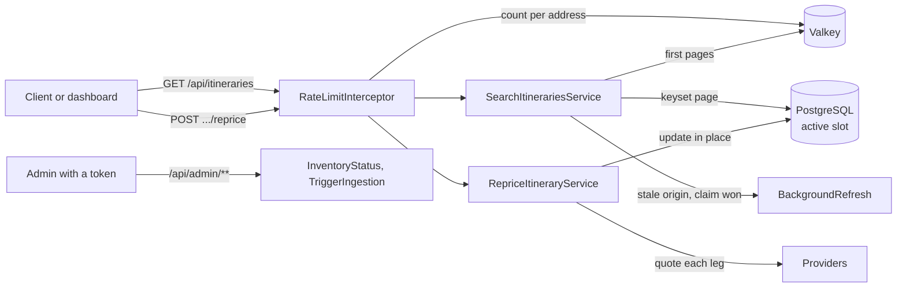

# Search API

The HTTP API over the published inventory: a public search and a public re-price, both limited per client address, and an admin side behind Keycloak tokens. It reads PostgreSQL and Valkey only; re-price is the one public call that reaches the providers. The contract the application serves is committed as [`openapi.json`](openapi.json), and the dashboard's types are generated from it. The reasoning behind each choice is in the [design spec](../planning/design-spec.md) (§4, §5.4, §6.2 to §6.6) and in [plan 5](../planning/plans/2026-11-15-search-api.md) (Q1 to Q9).

## Endpoints

| Endpoint | Access | Answers |
|---|---|---|
| `GET /api/itineraries` (and `HEAD`, the same without its body) | public, 60 a minute per address | `200` a page; `400` a bad parameter or cursor; `429`; `503` the inventory not read in time |
| `POST /api/itineraries/{id}/reprice` | public, 10 a minute per address | `200` `CONFIRMED`, `PRICE_CHANGED` or `ALTERNATIVE`; `400` not an id; `404` not on sale; `429`; `503` nothing confirmable, or the inventory not read in time |
| `GET /api/admin/status` | `ADMIN` | `200` the inventory's and each provider's status; `401`; `403`; `503` the inventory not read in time |
| `POST /api/admin/ingestions` | `ADMIN` | `202` a run started; `409` a run is going on; `401`; `403` |
| `GET /health` | public (status only; components for `ADMIN`) | `200` `UP` or `DEGRADED`; `503` `DOWN` |
| `GET /v3/api-docs` | public | the OpenAPI contract |
| `GET /swagger-ui.html`, `/swagger-ui/**`, `/v3/api-docs/swagger-config` | public, `GET` only | Swagger UI over that contract (extra E2) |
| `GET /.well-known/oauth-protected-resource` | public | Spring Security's own resource-server metadata (RFC 9728), which every `401`'s `WWW-Authenticate` names; it holds no secret |

Every other path needs a token with the `ADMIN` role.

A value that may be missing is present and `null`: the search's `nextCursor` on the last page, and the admin status's `publishedAt`, `nextIngestionAt` and each provider's `newestQuotedAt` before there is one. The one exception is the re-price's `previousPrice` and `notice`, each of one outcome only, which are left out where they do not apply: springdoc cannot write a nullable reference to an object schema (`Price`) that OpenAPI 3.1 reads as one. A client reads each field as the contract states it (plan 5 Task 10's review, C-m3).

Every error the application writes is an RFC 9457 problem (`application/problem+json`) whose `detail` names the parameter or says what to do; a `429` and a `503` carry `Retry-After` in whole seconds. So is every error Spring MVC answers itself, such as a `404` for a path the API does not serve or a `405` for a method an endpoint does not take (`spring.mvc.problemdetails.enabled`, G1, the user's decision of 2026-11-16); an anonymous client meets these only on the public paths, since Spring Security answers every other path `401` first. A `401` or `403` is Spring Security's bearer challenge: a `WWW-Authenticate` header and no body. The contract documents each of these on its own operation, the admin bearer scheme (`bearer`, a JWT) on the admin operations only, and `OpenApiContractTest` fails when the served contract drifts from the committed file or loses any of them.

## Search

`GET /api/itineraries` takes `origin`, `destination`, `carrier` (codes in either case), `maxPrice` (a decimal with at most two decimals, above zero, inclusive), `sort` (`price` by default, `departure` or `duration`), `limit` (20 by default, 1 to 100) and `cursor`, all optional. `carrier` keeps the trips whose every leg is flown by that carrier. Only departures after now are listed (§4.1). A result carries what a result card shows (§6.8): the trip's airports, local times with their offsets, duration, stops, price in EUR as a decimal string, `quotedAt` (for "updated X min ago") and its legs; never a provider or a leg's price.

**Keyset pages (§5.4).** A page is read as one SQL statement over the active slot: the filters, then `(sort key, id) > (cursor's position)`, `ORDER BY sort key, id`, one row more than the page so that `nextCursor` is given only when another page exists. There is no total count. Each slot has one index per sort order, keyed by id: alone, behind `origin, destination` (Q6-B), behind `origin` alone (V8, Q6-C, the user's decision at the end-of-plan review: without it, an origin searched without a destination walked the whole slot's price index, and a long-haul airport, whose trips are the dearest, outran the read's bound), and behind `destination` alone (V9, the user's decision at that round's re-review, for the same walk when a destination is searched without an origin). So every combination is an index scan; the plans are in the measures below. A read is one read-only `REPEATABLE READ` transaction bounded at 2 s, so the page and its generation come from one snapshot.

**A read cut by its bound.** A read that takes longer than 2 s is cancelled by PostgreSQL (`57014`) and rolled back, logged at `WARN`, and answers `503` with `Retry-After: 60` and *"The flights could not be read in time: try again after the seconds in Retry-After."*, not a `500`: the request is sound and may succeed later. 60 s is the plan's one `503` wait (Q9, re-price's), as a cut read means PostgreSQL is loaded and an immediate retry would add to it. A re-price whose read is cut answers the same. So does a read that gets no pooled connection within the pool's 2 s wait (`spring.datasource.hikari.connection-timeout`), whether every connection is in use or PostgreSQL is out of reach: one `WARN` line, `A read of the inventory got no pooled connection within the pool's wait`, and the same `503`, where it was a `500` (G1, the user's decision of 2026-11-16).

**The cursor and the generation (§6.3, Q1-A).** `nextCursor` is opaque: base64url of `1|generation|sort|price|departure|duration|id`, at most 200 characters, not signed (E3 rejected: a forged cursor only seeks within public data). Anything else, or a cursor of another sort order, is a `400`. Every publication, a full run or a refresh, bumps the generation; a cursor of an older generation still seeks from its position, in the new generation, and the page says `inventoryChanged: true`, the dashboard's "results updated, reload".

**The result cache (§6.2, Q3-A).** Only first pages of searches without `maxPrice` are cached in Valkey, under `search:<generation>:<sort>:<origin>:<destination>:<carrier>:<maxPrice>:<limit>`, for 5 minutes (`search.cache-ttl`) or until the page's first departure, whichever is sooner. A new generation leaves every cached page behind without a key deleted; old keys expire. Valkey runs with `maxmemory 256mb` and `allkeys-lru`. Hits, misses and errors are counted as `search.cache{result}`.

**A known limitation: one memory budget for the cache and the coordination** (accepted by the user on plan 5's closing round 2, M3). Valkey holds, besides the cached pages, the refresh claims (`refresh:<origin>`), the freshness marks (`fresh:<origin>`) and the rate-limit counters (`rate:<action>:<address>`), all under the one `allkeys-lru` budget. A cache that fills its 256 MB evicts them as readily as old pages: an evicted claim lets a second search ask for the same origin's refresh (the refresh lock still runs one at a time), an evicted mark makes an origin count as stale again, and an evicted counter starts a client's window again. Filling it takes about 3,000 distinct first pages of 100 itineraries, an estimate of the end-of-plan risk review, not a measure. A production deployment would give the coordination its own Valkey instance or its own memory budget.

**The stale-route refresh (§6.4, Q2-B).** A search with an origin whose last publication or refresh is more than 10 minutes old (`search.freshness-threshold`) claims the origin in Valkey (`SET refresh:<origin> NX`, 2 minutes) and, if it wins, starts the origin's refresh in the background; the search does not wait for it. One refresh runs at a time in the whole application (the user's decision at the end-of-plan review): a refresh asked for while another runs is skipped before it downloads anything and gives its claim back, so the next search that finds the origin stale asks again; nothing is queued. How a refresh rewrites the active slot is in [Ingestion](ingestion.md#the-stale-route-refresh).

## Re-price on selection

`POST /api/itineraries/{id}/reprice` quotes every leg of the chosen itinerary live from its provider, at once (§6.3). A leg its provider does not confirm (it no longer sells the flight, fails, or rejects the call over its concurrency limit) is quoted from the other providers that stored an offer of the same flight, cheapest first. A failure of a kind the provider port does not name, a bug, counts as that provider failing too, as in a run (`UNEXPECTED`; the user's decision on plan 5's closing round 2, §6.5's "always try"): it is counted as `provider.calls{operation=quote,outcome=UNEXPECTED}` and logged as one `ERROR` line, `A provider's quote failed unexpectedly`, with its provider and stack trace, and the re-price goes on. The same price answers `CONFIRMED`, another `PRICE_CHANGED` with `previousPrice`; either way the stored itinerary is updated in place, generation unchanged (Q5-A). If the choice cannot be confirmed, up to 3 itineraries of the same route are tried by price, and the first confirmed is the answer, `ALTERNATIVE`, with the notice *"We couldn't confirm this flight. This is the best alternative we found."* (§6.5). When nothing is confirmed, the answer is a `503` with `Retry-After: 60` and *"We can't confirm the price right now. Please try again in a few minutes."* No quote starts after 10 s; one already started is bounded by its provider's own timeouts (2.5 s a request, 3 attempts), so the slowest `503` takes 10 s plus that quote: with every provider stopped, the first took 13.8 s. The user kept this as built at the end-of-plan review: Q9 says only that no quote starts after 10 s, and the breakers, open after that first answer, make the next ones fast (1.35 s, then 0.02 s). A departed choice takes the alternative flow. While a run or a refresh holds the inventory, the update is skipped (`reprice.store{outcome=BUSY}`, one `WARN` line) and the live answer still stands.

## Rate limit

Search and re-price are counted per client address in fixed windows of one minute, each on its own counter (`rate:<action>:<address>`), shared by every instance through Valkey (§6.6, Q9-A): 60 searches and 10 re-prices. A request past the limit answers `429` with `Retry-After`, the seconds left in its window. The address is the connection's; Tomcat takes `X-Forwarded-For` only from a private-range or loopback proxy, such as the dashboard's nginx.

## Valkey down

Valkey is a cache and a coordinator, never a source of truth (§6.2). A failed command is a cache miss, an unclaimed refresh and an admitted request; after a failure, Valkey is skipped for 10 s (`search.valkey-skip`), then one call probes it, so an outage costs a search at most one 250 ms command timeout, not one per command. The outage is one `WARN` line, `Valkey is unavailable…`, and its end one `INFO` line, `Valkey answers again`.

## Admin side and health

The admin endpoints need a JWT whose `realm_access.roles` holds `ADMIN`, signed by Keycloak's realm `flight-aggregator` (§6.6). How to get a token with the `admin-service` client is in the [README](../../README.md#admin-access). `GET /api/admin/status` shows the generation, when it was published, when the next run is due, and each provider's health, breaker state, newest quote, legs and discarded records (Q7-B: recorded at the end of every run, so every instance shows the same). `POST /api/admin/ingestions` starts a run under the same ShedLock lock as the scheduled one.

`/health` is `DEGRADED`, still `200`, when a provider is not `UP` (its last run kept its offers, or its breaker is not closed) or Valkey does not answer, and `DOWN` (`503`) only when PostgreSQL is (Q8-A). With PostgreSQL out of reach it answers `DOWN` in about 2 s, well inside compose's 5 s health check (end-of-plan review, F-I1): a request waits at most 2 s for a pooled connection (`spring.datasource.hikari.connection-timeout`, not Hikari's 30 s; 2 s rather than 1 s is the user's decision at the re-review, so a burst that holds every connection for about a second fails no run, store or re-price), once, for the inventory's component, which reports a status it cannot read as `DOWN` (Boot's `AbstractHealthIndicator`) rather than letting the failure escape as a `500`. Boot's `db` component, which would add a second wait (about 4 s in all), is left out of this group by the user's decision of 2026-11-16; the management port's `/actuator/health` keeps it. Compose's health check of the app accepts `UP` and `DEGRADED`.

Actuator itself is on the management port, 8079, reached only on compose's network and open there with no token: `/actuator/health` (the same status), `/actuator/metrics` and `/actuator/prometheus`, which Prometheus scrapes (§6.6, the user's decision of 2026-11-15). The API port serves no Actuator endpoint. Its `/health` is the additional path of a health group (`management.endpoint.health.group.api`), which takes every component but `db` (`management.endpoint.health.group.api.exclude: db`) and the root health's settings; Boot accepts only one segment there, hence `/health` and not `/actuator/health` (plan 7, the user's decision of 2026-11-16).

## Measured on the real volume

On `docker compose up --build` (plan 5 Task 13, 2026-11-16, an Apple-silicon Mac, Docker Desktop with 10 CPUs and 7.7 GiB), with 1,033,722 itineraries published; every command and number is in the [progress report](../planning/progress/2026-11-15-search-api.md#task-13--evidence):

- **A run** takes 24 to 28 s, against plan 4's 12 to 14 s: the `COPY` maintains the six sort indexes (about 15 s) and `ANALYZE` adds about 5 s.
- **A page,** in PostgreSQL, takes under 2 ms for most of the 24 measured combinations (3 sorts × no filter, origin, origin and destination, carrier × first and fiftieth page), and at most 42 ms warm: departure order with only an origin, which walks the departure index of every day partition. Over HTTP a page answers in 4 to 60 ms (the first request after startup, 104 ms), and a cached first page in about 5 ms; 50 pages through their cursors gave 1,000 rows with none repeated.
- **A refresh** of Madrid rewrote 530,603 itineraries in 15 s and held the publication row 14 s: 1.5 s of `DELETE`, then the build and `COPY` of the itineraries. Three origins refreshed at once: one succeeded, the two others gave up on the row's 5 s lock timeout, the second after 8 s because it queued behind the first. A refresh of a hub rewrites half the inventory (every trip with a leg from it), and its dead rows slow the first reader of that origin (up to 0.3 s) until autovacuum, which took them within two minutes.
- **Re-price** answers in 0.1 to 1 s with every provider up and 0.5 to 6 s with Beta failing; with every provider stopped, the first `503` took 13.8 s (the 10 s budget plus a quote in flight), the next ones 1.4 s and 20 ms once the breakers opened.
- **Valkey stopped:** searches answered in 4 to 30 ms, health `DEGRADED` with `200`, and the cache came back on its own when Valkey did.
- **Rate limit:** of 61 searches sent within one second, 60 answered `200` and the 61st `429` with `Retry-After: 59`.

After the end-of-plan review's fixes (closing round 1, 2026-11-16, the same Mac shared with other stacks, so timings are noisy; every number is in the [progress report](../planning/progress/2026-11-15-search-api.md#end-of-plan-fix-round-1--importants)):

- **Origin without a destination:** with V8, the first and fiftieth pages of JFK, GRU, DXB, NRT and MAD in each sort took 1.1 to 22 ms cold (PostgreSQL restarted before each) and 0.4 to 7.1 ms warm, against up to 1,351 ms cold and 948 ms warm without it (JFK by price, first page). Over HTTP, 13 origins × 3 sorts answered `200`, the slowest in 0.64 s uncached.
- **Destination without an origin** (V9, the re-review): the first and fiftieth pages to NRT, JFK, GRU, DXB and MAD in each sort took 0.8 to 4.6 ms cold and 0.3 to 2.7 ms warm, against up to 499 ms cold and 434 ms warm without V9 on the same host (NRT by price, first page; the re-review measured 3 to 4 s on a busier one).
- **A run** with V8's three more indexes per slot took 31 to 55 s on that busy host, against 33 to 41 s with them dropped there, minutes apart (Task 13 measured 24 to 28 s on a quieter one): its `COPY`, which maintains nine indexes per slot instead of six, took 28 to 37 s against 20 to 27 s. With V9's three more (twelve per slot), on a quieter host, runs took 34.9 to 41.6 s (`COPY` 22.8 to 28.4 s) against 31.4 to 33.6 s (`COPY` 20.0 to 20.8 s) with V9's indexes dropped, minutes apart.
- **Health with PostgreSQL stopped,** with the 2 s connection wait: 12 probes of `/health`, each `DOWN` with `503` in 4.01 to 4.06 s.
- **Refresh bursts:** 32 origins searched at once, twice, then again with a manual run and three re-prices 150 ms after: one refresh ran each time and the other 30 or 31 were skipped, with no provider call rejected and no `ERROR` line; every search answered `200` within 0.5 s and every health probe `200` within 0.3 s; both runs published with every provider fresh, and the re-prices answered `CONFIRMED` or `PRICE_CHANGED` in 0.75 to 4.9 s. Before the fix, the same probe gave 13 refreshes failing on the row's lock timeout, 7 with every download rejected, a 5 s search and a 4.7 s health probe, a run keeping two healthy providers, and a re-price `503` with every provider up.
