# Flight Aggregator user manual

This manual shows how to use the Flight Aggregator: how a customer searches flights, how an admin watches the providers and starts an ingestion, how the team reads its metrics, traces and logs in Grafana, and how a developer tries the API in Swagger UI. It describes only what the application does.

- **Version:** manual `v1.2.0`, for the application as released in `v1.1.0` (the manual changes no code).
- **Readers:** the reviewers of this take-home, and anyone who runs the stack on their own machine.
- **Why it works the way it does:** the [architecture documents](../architecture/README.md) and [SOLUTION.md](../../SOLUTION.md). This manual links to them and does not repeat them.
- **PDF:** [`user-manual.pdf`](user-manual.pdf) is generated from this file, which is the source of truth.

## Contents

- [Before you start](#before-you-start)
- [1. Customer: searching flights](#1-customer-searching-flights)
- [2. Admin: provider status and ingestion](#2-admin-provider-status-and-ingestion)
- [3. Monitoring with Grafana](#3-monitoring-with-grafana)
- [4. The API in Swagger UI](#4-the-api-in-swagger-ui)
- [5. Troubleshooting](#5-troubleshooting)
- [Glossary](#glossary)

## Before you start

1. Start the stack with `docker compose up --build`, as the [README](../../README.md#run-the-aggregator) explains. It needs Docker with Compose v2, at least 4 GB of memory for Docker and the free ports the README lists ([Requirements](../../README.md#requirements)).
2. Wait for the first ingestion. The aggregator downloads the three providers when it starts and publishes about a million itineraries, which takes about a minute on a recent machine. Until then a search finds no flights.
3. Open the address you need. Every service listens on your own machine only:

| What | Address | Who uses it |
|---|---|---|
| Dashboard: the flight search | `http://localhost:3000` | Customers |
| Dashboard: the provider status | `http://localhost:3000/admin` | Admins (sign-in) |
| API and Swagger UI | `http://localhost:8080/swagger-ui.html` | Developers |
| Grafana | `http://localhost:3001` | The team (no sign-in) |
| Prometheus | `http://localhost:9090` | The team (its alerts page and queries) |
| Keycloak | `http://localhost:8180` | Issues the admin's sign-in and tokens |

The screenshots in this manual come from a stack running `v1.1.0`. The flights, prices and times in them change with every ingestion, so yours will differ.

## 1. Customer: searching flights

The search page is public: anyone who opens `http://localhost:3000` can search, with no account.

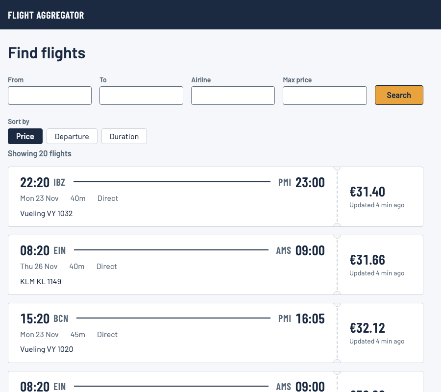

*The search page as it opens: with no filter, it lists the cheapest flights of the whole inventory.*

### Find flights between two airports

1. Type the departure airport in **From** and the arrival airport in **To**: the airport's three-letter code (`MAD`) or its city's full name (`Madrid`), in any case. As you type, the browser suggests the dataset's airports, each as "MAD — Madrid"; pick one or keep typing.
2. Optionally, type an airline in **Airline**: its two-character code (`IB`) or its full name (`Iberia`), in any case. The browser suggests the dataset's airlines, each as "IB — Iberia". The search then keeps only the trips whose every leg that airline flies.
3. Optionally, type the highest price you would pay in euros in **Max price** (`700`, `149.99` or `149,99`). Flights at exactly that price are included.
4. Press **Search**.

Every filter is optional: leave one empty to search all its values. The search lists only flights that have not departed yet. There is no date filter and no filter by number of stops.

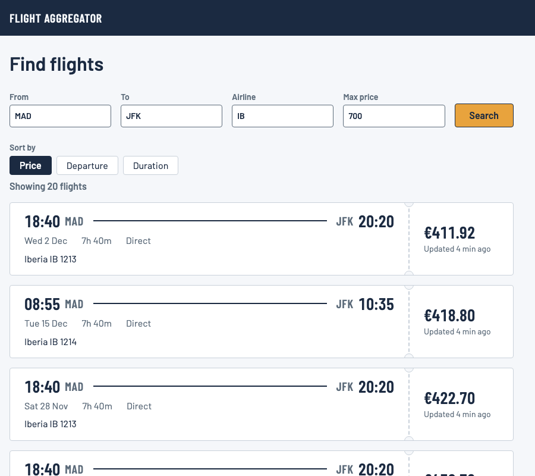

*A search from Madrid (MAD) to New York (JFK) on Iberia (IB) for 700 euros or less.*

The airports and airlines the dataset holds are listed in the README: [Airports in the dataset](../../README.md#airports-in-the-dataset) and [Airlines in the dataset](../../README.md#airlines-in-the-dataset). An airline code that no flight uses is not an error: it finds no flights.

The address bar holds the search (for example `/?origin=MAD&destination=JFK&carrier=IB&maxPrice=700`). Copy it to share or bookmark the search, and use the browser's Back button to return to the previous one.

### Read a result card

Each card reads like a boarding pass:

- **The route:** the departure time and airport on the left, the arrival time and airport on the right, and a dot on the line for each stop. "+1 day" after the arrival time means the trip lands the next day, local time ("+2 days" two days later).
- **The details:** the departure date, the total duration, and "Direct" or the stops, each with its airport and how long you wait there ("1 stop: LHR, 1h 10m").
- **The flights:** each leg's airline and flight number ("Iberia IB 1213"), and "Multiple airlines" when more than one airline flies the trip.
- **The price,** on the right, in euros, with how recently it was quoted ("Updated 4 min ago").

Every time is the local time at its own airport, as on a boarding pass, whatever your computer's time zone.

### Find the cheapest, the earliest or the shortest flight

Under **Sort by**, choose:

- **Price** (the default): the cheapest first.
- **Departure:** the earliest departure first.
- **Duration:** the shortest trip first, stops included.

To find the cheapest direct flight, search your route sorted by **Price** and read the details line of the first cards: "Direct" marks the flights with no stop.

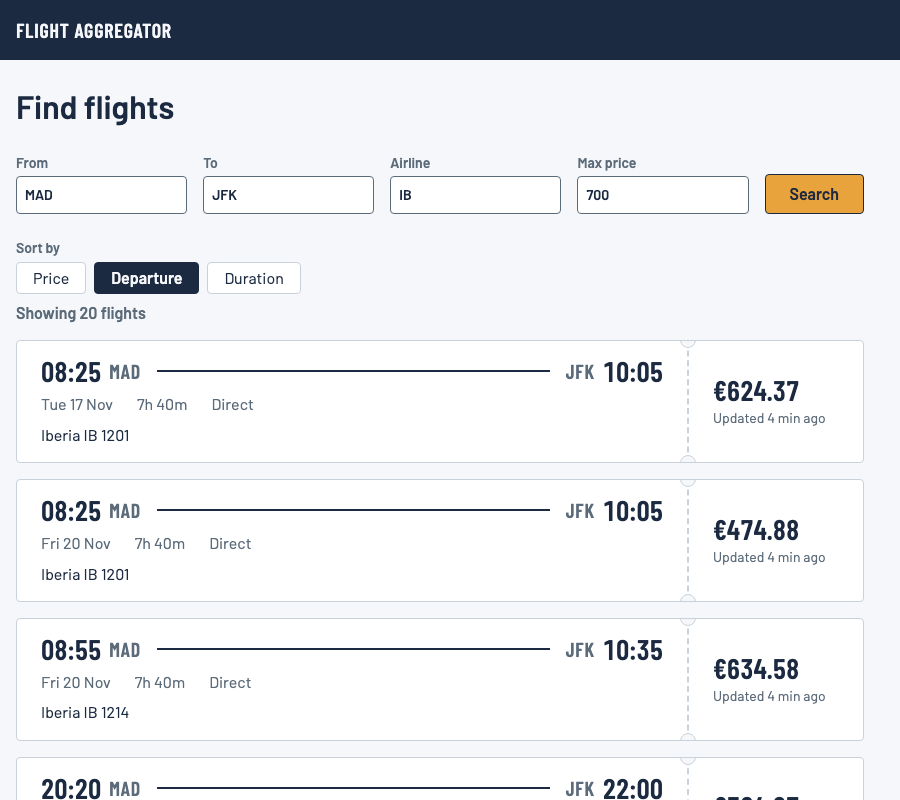

*The same search sorted by **Departure**. The sort is part of the address too.*

### See more results

The page shows 20 flights at a time, and "Showing N flights" above the list counts the flights shown. When more flights match, **Load more** appears below the last card. Press it to add up to 20 more; the focus moves to the first new card.

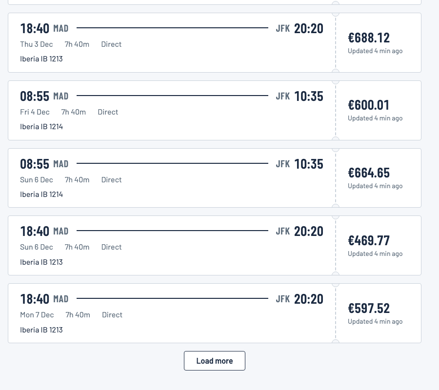

*"Load more" adds the next page under the flights already shown.*

### When the search cannot run

- **A value the search cannot use** is shown under its field, and no search is sent. For example, a partial city name ("Madri") asks for "Enter a 3-letter airport code, like MAD". Correct the field and press **Search** again.
- **No flight matches:** the page says "No flights match these filters. Remove a filter or raise the maximum price."

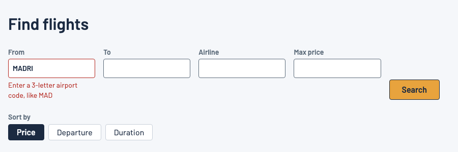

*A From value that is neither an airport code nor a full city name.*

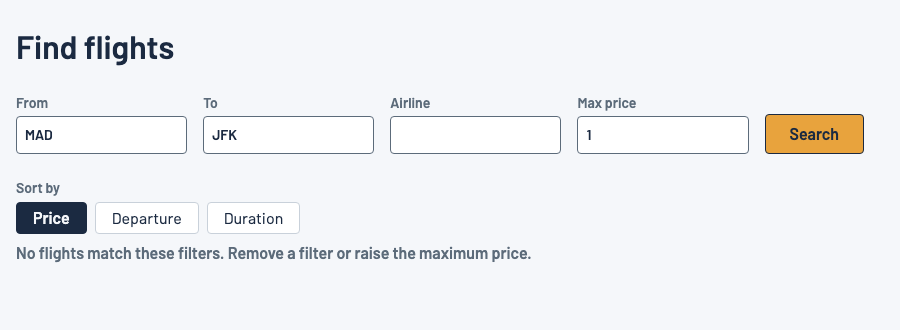

*No flight from Madrid to New York costs 1 euro or less.*

### Open a flight and check its price

Click a card to open it. The card then shows each leg, and asks the providers for the current price of every leg. This live check is the re-price.

The example below is a trip from Edinburgh (EDI) to Bogota (BOG) with two stops. The summary names each stop and its layover: 9 hours 40 minutes in London (LHR) and 14 hours 15 minutes in Madrid (MAD). The trip lands the next day, local time, so the arrival shows "+1 day". The opened card lists the three legs, each with its flight, its airports and its local times; a leg that lands on a later day than it took off shows "+1 day" too.

*An itinerary with two stops, opened: the summary gives the layovers, the list below gives each leg.*

While the price is checked, the card says "Checking the price…". Then it shows one of these answers:

| The card says | What it means |
|---|---|
| "Price confirmed: €437.33" | The providers confirm the price the card showed. |
| "Price changed: was €411.92, now €460.71" | The price has changed since the search. The card's price on the right shows the new one. |
| "We couldn't confirm this flight. This is the best alternative we found." | The chosen flight could not be confirmed, so the search offers another itinerary on the same route. Its legs appear under "Alternative legs", with a date before the time of any leg that leaves on another day than the chosen flight. |
| "We can't confirm the price right now. Please try again in a few minutes." | No provider could confirm this flight or an alternative. |
| "This flight is no longer available. Search again for current flights." | The flight is no longer on sale. |

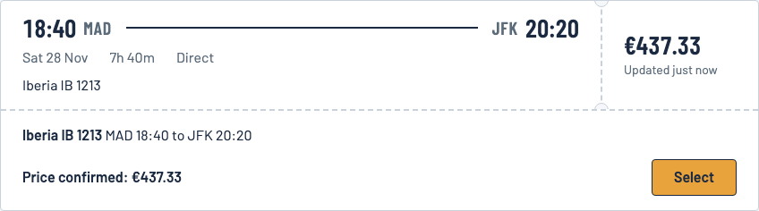

*A confirmed price.*

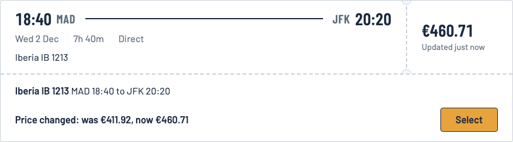

*A changed price: the card's price shows the new amount.*

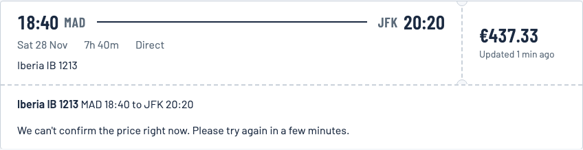

*No provider answered: here the three providers were stopped on purpose.*

A confirmed, changed or alternative price comes with a **Select** button. Booking is not part of this demo, so **Select** goes no further and says "Booking is not part of this demo."

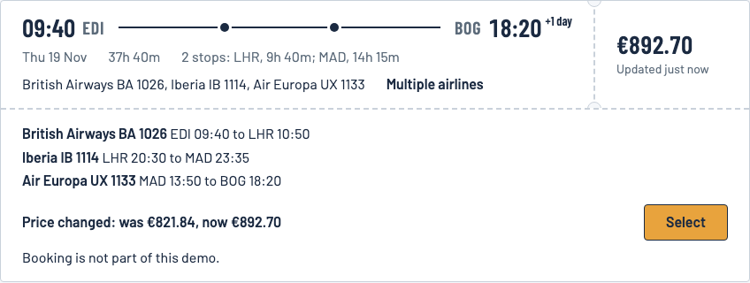

*Select ends the demo's flow.*

Each opening checks the price again: close the card and open it later to see the price at that moment. This manual has no screenshot of the alternative: it needs one provider to fail a flight that no other provider sells while the others answer, which the demo stack does not do on its own.

### When the results change while you browse

The aggregator downloads the providers again every 30 minutes, and an admin can start a download at any time. A search from an airport whose flights are more than 10 minutes old also asks for that airport's flights again, in the background, without waiting for them. When you press **Load more** after new flights have been published, the page adds the next flights of the new inventory, without repeating the ones already shown, and says "Results updated." with a **Reload** button.

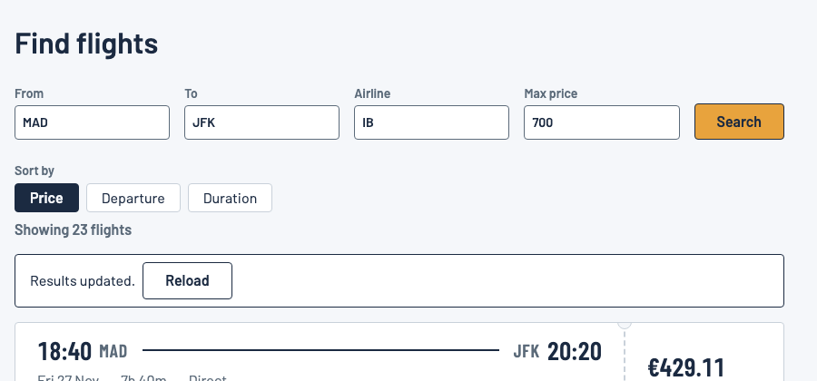

*New flights were published between the first page and "Load more".*

The flights already on the page stay as they were. Press **Reload** to read the search again from its first page, with the current flights and prices.

### Search on a phone

The page works on a phone's width: the filters stack one above the other, and each card puts its price under the flight.

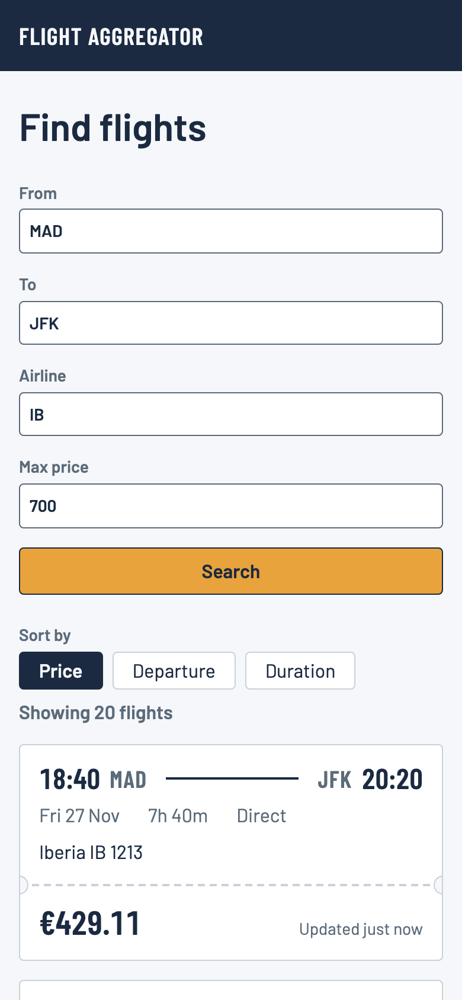

*The search at 390 pixels wide.*

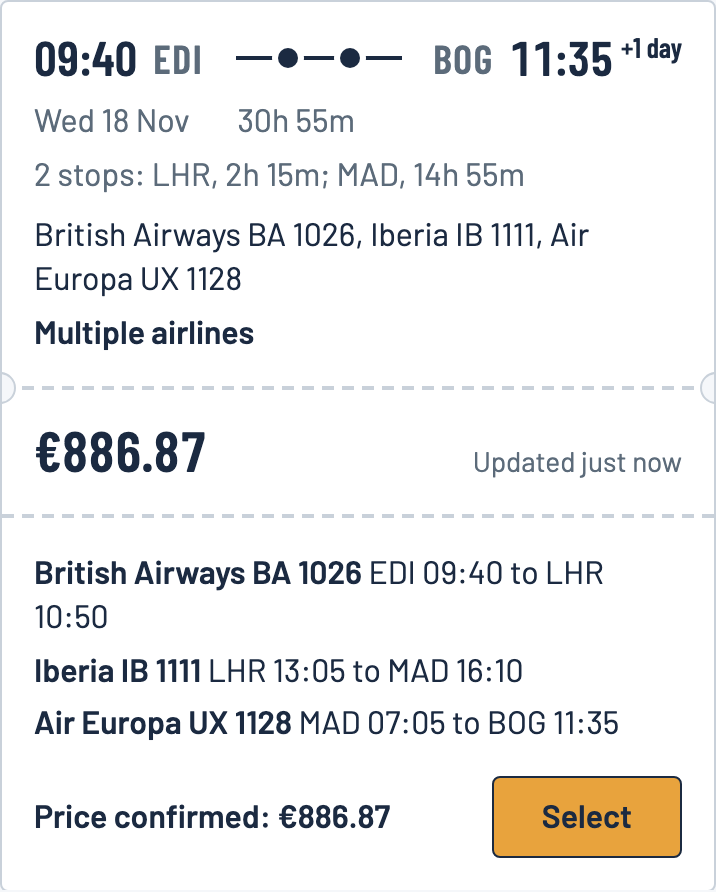

*An opened card on a phone.*

### How many searches you can make

Each client address, in practice your connection, may make 60 searches and 10 price checks a minute. Past that, the page tells you how long to wait:

- "Too many searches from your connection. Try again in N seconds."
- "Too many price checks from your connection. Try again in N seconds."

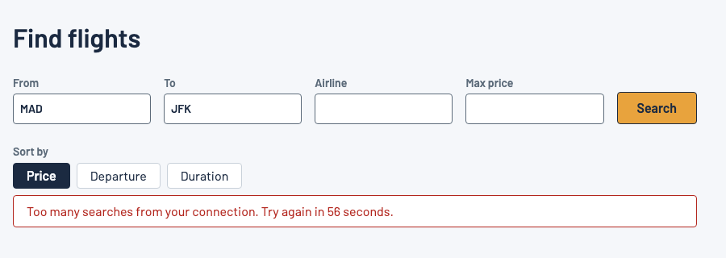

*The search's limit: wait the seconds it gives, then press Search again.*

During the wait the page offers no "Try again" and no "Load more". When the wait is over, press **Search** again, or **Load more** if the limit stopped a next page: the pages already loaded stay. Any other failure says "Flights could not be loaded. Search again in a moment." with a **Try again** button.

## 2. Admin: provider status and ingestion

The admin screen shows how the last ingestion went and lets you start a new one. It needs an account with the admin role.

### Sign in

1. Open `http://localhost:3000/admin`. The page says "Signing in…" and sends you to Keycloak's sign-in page.
2. Enter the demo admin's username, `admin`, and the password the README gives in [Admin access](../../README.md#admin-access).
3. Press **Sign In**. Keycloak sends you back to the provider status.

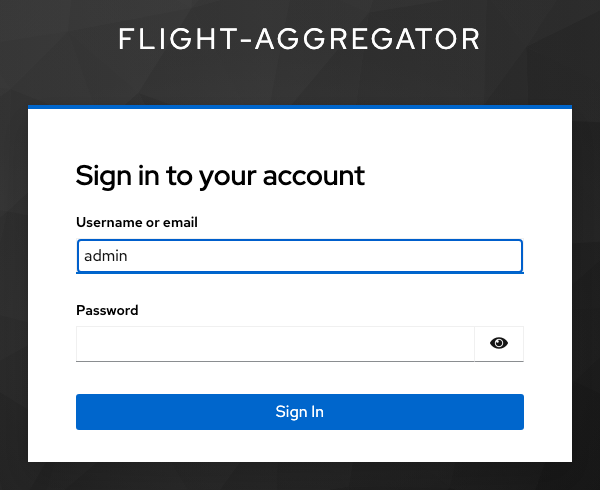

*Keycloak's sign-in page.*

While your Keycloak session lasts, reloading the page or opening it again does not ask for the password. **Sign out**, at the bottom of the screen, ends the Keycloak session too and shows the sign-in page again.

### Read the provider status

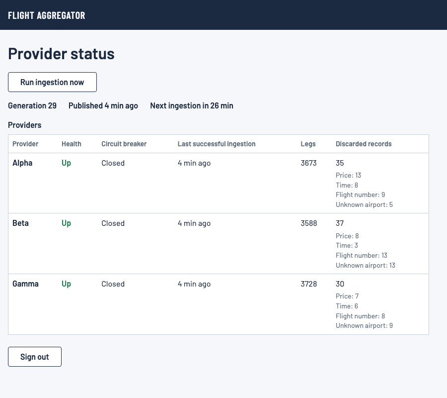

*Every provider healthy after the last run.*

The line under the button describes the published inventory:

- **Generation N:** the number of the published inventory. Each publication adds one: an ingestion, or a search's background refresh of one airport's flights (see [When the results change while you browse](#when-the-results-change-while-you-browse)).
- **Published 4 min ago:** when that generation was published.
- **Next ingestion in 26 min:** when the next scheduled run is due ("Next ingestion due" once its time has come). The aggregator runs one every 30 minutes.

Before the first run ends, the screen says "No ingestion has run yet.", or "First ingestion in progress." while it runs.

The **Providers** table has one row per provider, Alpha, Beta and Gamma:

| Column | What it shows |
|---|---|
| Provider | The provider's name. |
| Health | "Up", "Degraded" or "Down" (below). |
| Circuit breaker | "Closed": calls go through. "Open": recent calls failed, so calls are refused for 60 seconds. "Half-open": after those 60 seconds, a few trial calls test the provider again. |
| Last successful ingestion | How long ago its newest stored price was quoted, or "Never". |
| Legs | How many of its flight legs the inventory uses. "Kept from the last good ingestion" means its last download failed, so the inventory keeps its legs from an earlier run. |
| Discarded records | How many of its records the last run rejected, then each reason with its count ("Unknown airport: 5"). |

A provider's health reads:

- **Up:** its last download succeeded and its circuit breaker is closed.
- **Degraded:** its circuit breaker is half-open, testing the provider again.
- **Down:** its last download failed and its legs are kept from an earlier run, or its circuit breaker is open.

The screen reads the status again every 10 seconds while its tab is visible, so it shows a run start and end without a reload.

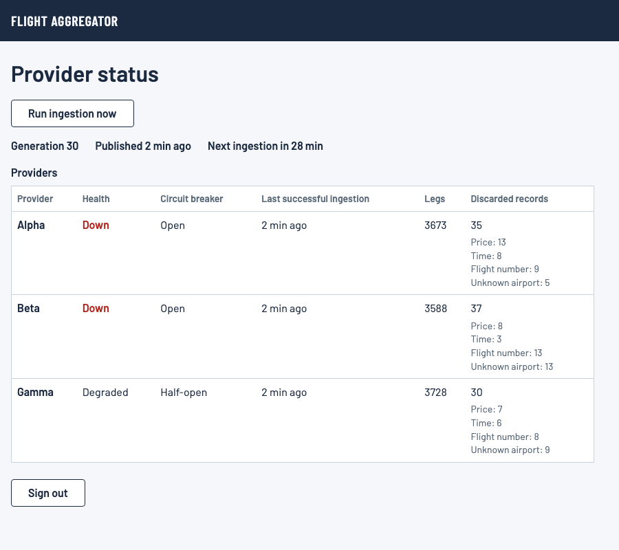

*The providers just after an outage: Gamma's breaker is half-open, testing it again; Alpha's and Beta's are still open.*

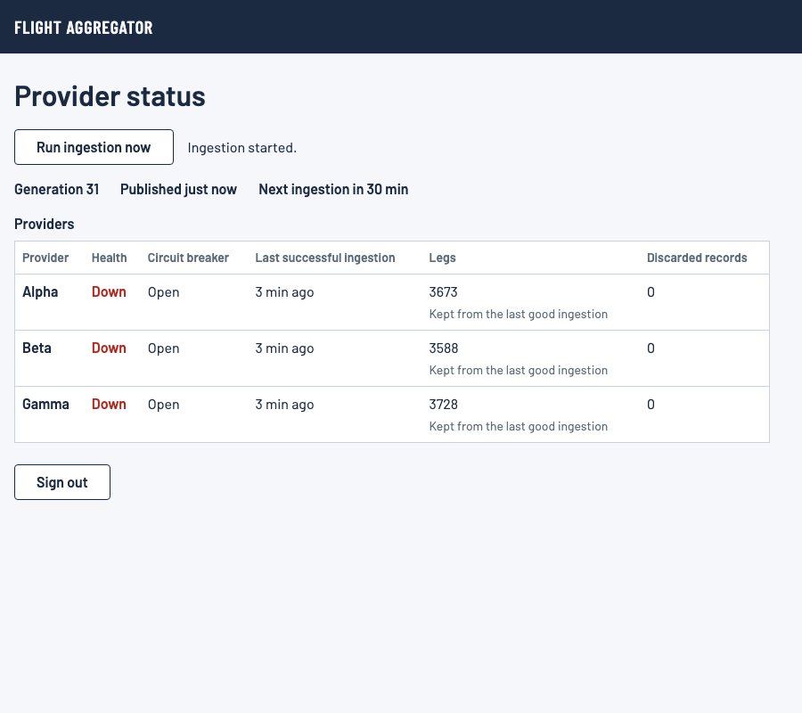

*A run while the providers were unreachable: the inventory keeps each provider's legs from the last good run.*

### Start an ingestion now

1. Press **Run ingestion now**. The screen says "Ingestion started." and the status line shows "Ingestion in progress" instead of the next ingestion's time.
2. Wait about a minute (more on a slower machine). When the run ends, the generation goes up by one, "Published" says "just now", and the table shows the new run's figures.

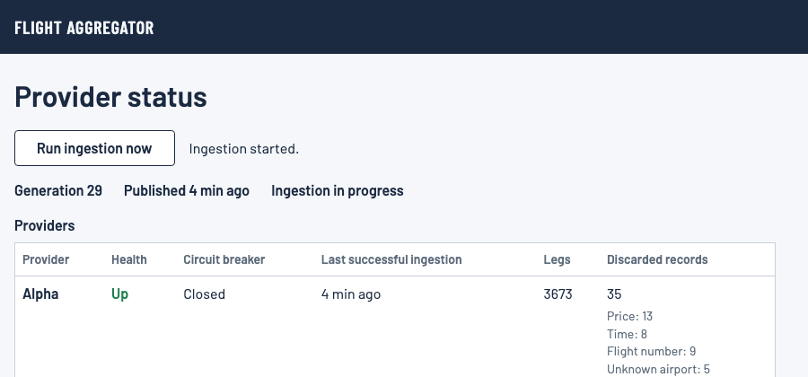

*A run on demand in progress.*

Only one run goes on at a time. If you press the button while a run is going on, scheduled or on demand, the screen says "An ingestion is already running." Wait for that run to end.

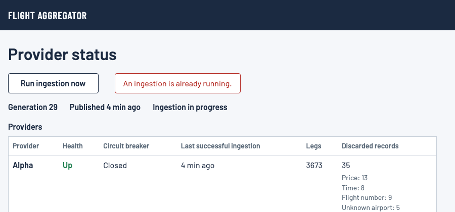

*A second press while a run is going on.*

Customers keep searching the previous inventory until the run publishes, and a run that fails leaves it in place. How a run works and what each failure does: [Ingestion](../architecture/ingestion.md).

### Messages on the admin screen

| The screen says | What to do |
|---|---|
| "Provider status could not be loaded. Retrying every 10 seconds." | Nothing: the screen tries again by itself. If it persists, check that the aggregator is running (`docker compose ps`). |
| "This account does not have the admin role." | Sign out and sign in with an account that has it. In the demo, `admin` has it. |
| "The API refused your session. Sign out and try again." | Press **Sign out** and sign in again. |
| "Sign-in failed. Reload the page to try again." | Reload the page. The browser's console says why the sign-in failed. |
| "The ingestion could not be started. Try again in a moment." | Press **Run ingestion now** again a little later. |

To call the admin endpoints from a script instead, with a token, follow the README's [Admin access](../../README.md#admin-access).

## 3. Monitoring with Grafana

Grafana shows the aggregator's metrics, traces and logs to the whole team. Open `http://localhost:3001`: there is no sign-in, and everyone is a viewer who can look and explore but not save changes. Its parts are described in [Observability](../architecture/observability.md).

### Read the dashboard

Open **Dashboards → Flight aggregator**, or go straight to `http://localhost:3001/d/flight-aggregator`. Its ten panels show:

| Panel | Shows |
|---|---|
| Provider calls | Calls per second to each provider, by outcome |
| Circuit breakers | Each provider's circuit breaker state, coloured |
| Data freshness | The age of each provider's newest data, red from 90 minutes |
| Ingestion | Runs in the last hour by outcome, run duration, failed runs in a row |
| Cache hit ratio | The share of searches answered from the cache in the last hour |
| Discarded records | Records rejected in the last hour, by provider and reason |
| Partitions | How many days ahead the inventory's storage is ready, and rows outside them |
| HTTP requests | Searches and re-prices per second by outcome, with their latency |
| Alerts | Every alert rule and its state |
| Logs | The aggregator's log lines, newest first |

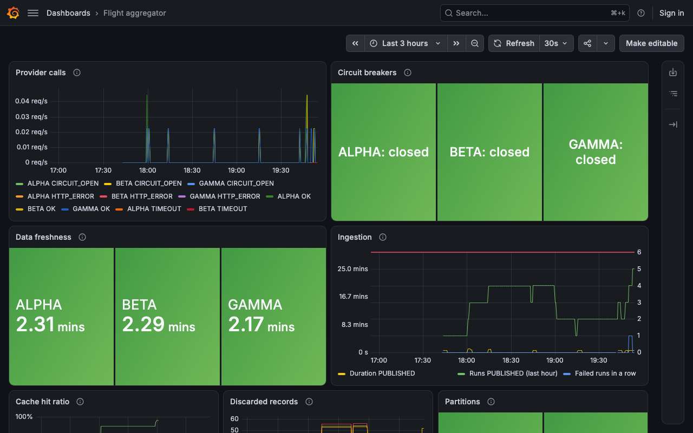

*The top of the dashboard. Scroll down for the other six panels.*

To look at one panel on its own, hover over its title, open the panel's menu and choose **View**, or press `v` while the pointer is over the panel. **Back to dashboard** returns to all ten.

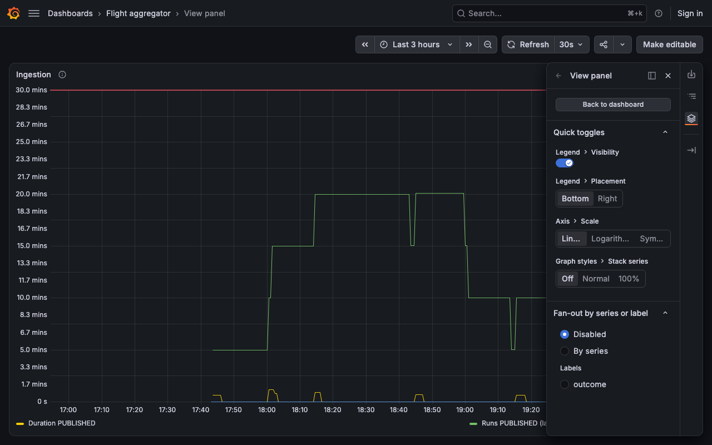

*The Ingestion panel, viewed alone, with its display options beside it.*

The time picker at the top right sets the period every panel shows. The alert rules are explained in [Observability, alert rules](../architecture/observability.md#alert-rules); Prometheus's own alerts page is `http://localhost:9090/alerts`.

### Follow an ingestion run from its log line to its trace

1. Open **Explore** (`http://localhost:3001/explore`) and choose the **Loki** data source.
2. Run the query `{service_name="flight-aggregator"} |= "Ingestion run ended"`.
3. Click a line to open its details.
4. Under **Links**, click **View trace** beside **TraceID**. The run's trace opens beside the logs: the run (`ingestion.run`) and one request per provider page to Alpha, Beta and Gamma.

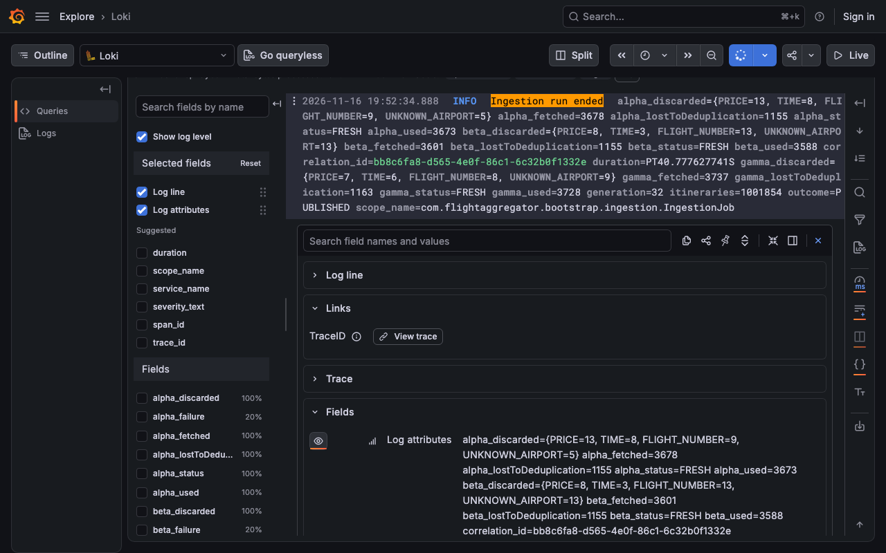

*A run's last log line, opened: it gives each provider's figures, and **View trace** links the run's trace.*

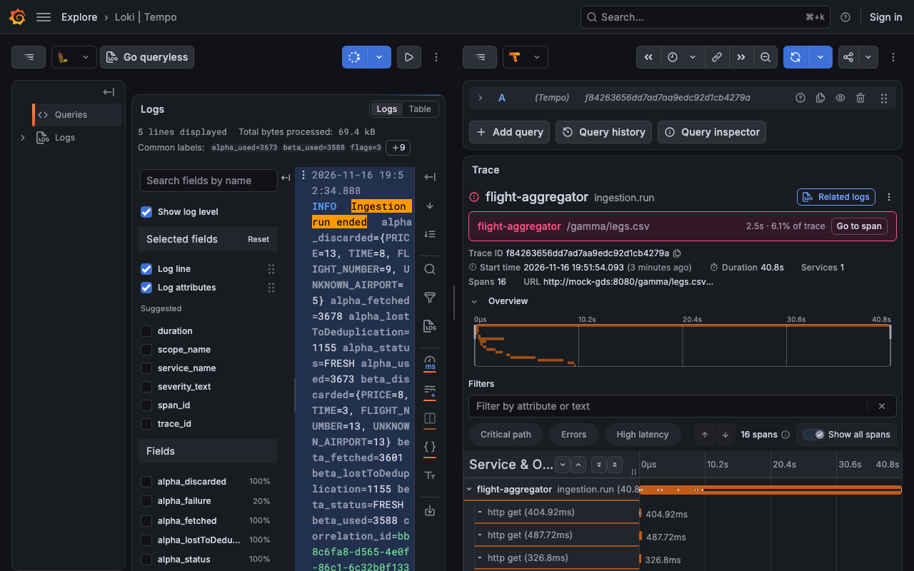

*The run's trace beside its logs.*

The way back works too: in a trace, **Related logs** (in its header or in any span's details) opens that trace's log lines. More LogQL examples are in [Observability, logs](../architecture/observability.md#logs).

## 4. The API in Swagger UI

Swagger UI lists every endpoint of the API and lets you call them from the browser. Open `http://localhost:8080/swagger-ui.html`. The contract it reads is committed as [`openapi.json`](../architecture/openapi.json), and [Search API](../architecture/search-api.md) explains each endpoint.

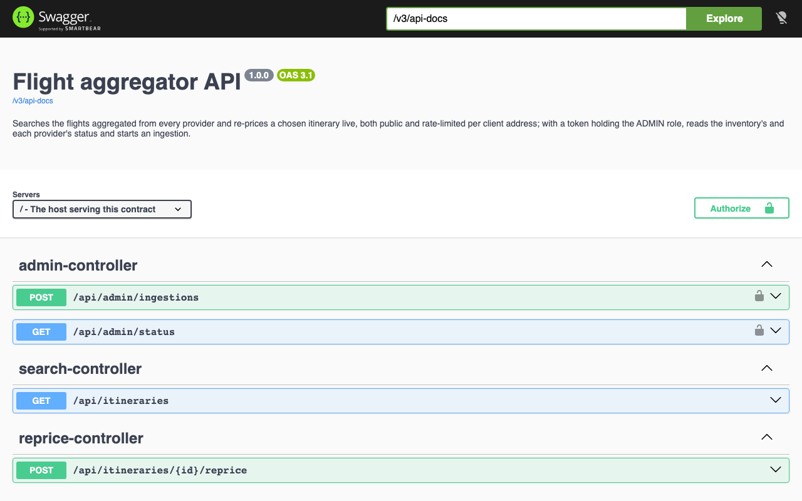

*The four endpoints: two public (search and re-price) and two for admins, marked with a lock.*

### Try a search

1. Open **GET /api/itineraries** and press **Try it out**.
2. Fill in the parameters you need, such as `origin` `MAD`, `destination` `JFK` and `limit` `2`. All are optional.
3. Press **Execute**. Swagger UI shows the equivalent `curl` command, the request URL and the response: the itineraries, each with its legs and price, and `nextCursor`.

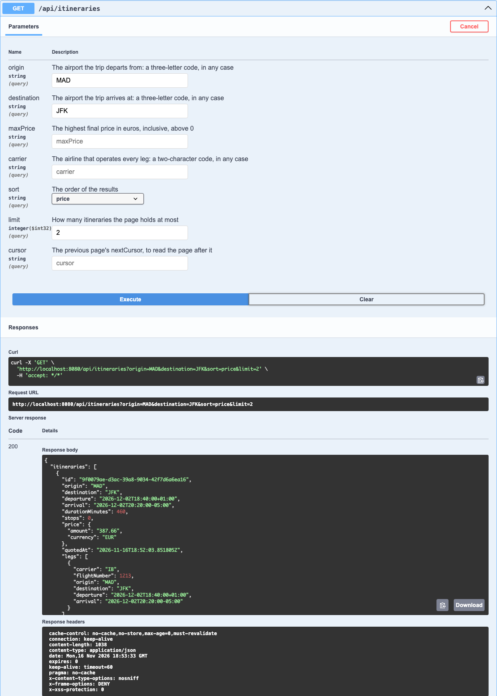

*A search tried from Swagger UI.*

To read the next page, copy `nextCursor` from the response into `cursor` and press **Execute** again. Re-price works the same way: copy an itinerary's `id` into **POST /api/itineraries/{id}/reprice**. The same limits apply as on the dashboard: 60 searches and 10 re-prices a minute per address.

### Call an admin endpoint

The admin endpoints answer `401` without a token.

1. Get a token as in step 2 of the README's [Admin access](../../README.md#admin-access). It lasts 5 minutes.
2. Press **Authorize**, paste the token alone (without `Bearer`) into the **Value** field, press **Authorize** in the dialog, then **Close**.
3. Try **GET /api/admin/status** or **POST /api/admin/ingestions**. Swagger UI sends the token with them until you reload the page.

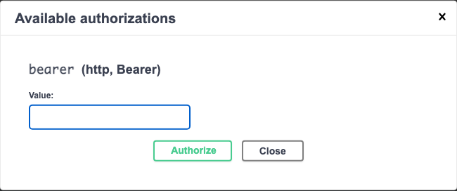

*The Authorize dialog, where the token goes.*

## 5. Troubleshooting

### The search shows no flights right after the start

The first ingestion has not published yet. It runs when the aggregator starts and takes about a minute, more on a slower machine. Wait, then search again. If the admin screen still says "No ingestion has run yet." a few minutes after the start, the first run may have failed: follow step 3 of [On an older or slower machine](../../README.md#on-an-older-or-slower-machine).

### "Results updated." appears

New flights were published while you were browsing, by an ingestion or a background refresh (see [When the results change while you browse](#when-the-results-change-while-you-browse)). Press **Reload** to read the search again with the current flights and prices.

### "Too many searches" or "Too many price checks" (429)

Your connection has made more than 60 searches or 10 price checks in the current minute. Wait the seconds the message gives, then search again. Every client on one address shares the count. The limits are the aggregator's `rate-limit.actions.*` settings ([Run the aggregator](../../README.md#run-the-aggregator)).

### "We can't confirm the price right now" (503 with Retry-After)

No provider could confirm the flight or an alternative. The API answers `503` with a `Retry-After` header that says, in seconds, when to ask again (60). Open the card again after that. If it keeps happening, an admin checks the provider status: the providers may be down. The card says the same when the dashboard cannot reach the API.

A search answers `503` with `Retry-After` too when the database cannot read the flights in time. The dashboard then says "Flights could not be loaded. Search again in a moment." with a **Try again** button; a client of the API waits the `Retry-After` seconds before asking again.

### A provider shows Degraded or Down

- **Degraded** (circuit breaker "Half-open"): the provider failed recently and is being tested again. It returns to "Up" when the trial calls succeed.
- **Down** with the breaker "Open": recent calls failed. The breaker refuses calls for 60 seconds, then tests the provider again.

  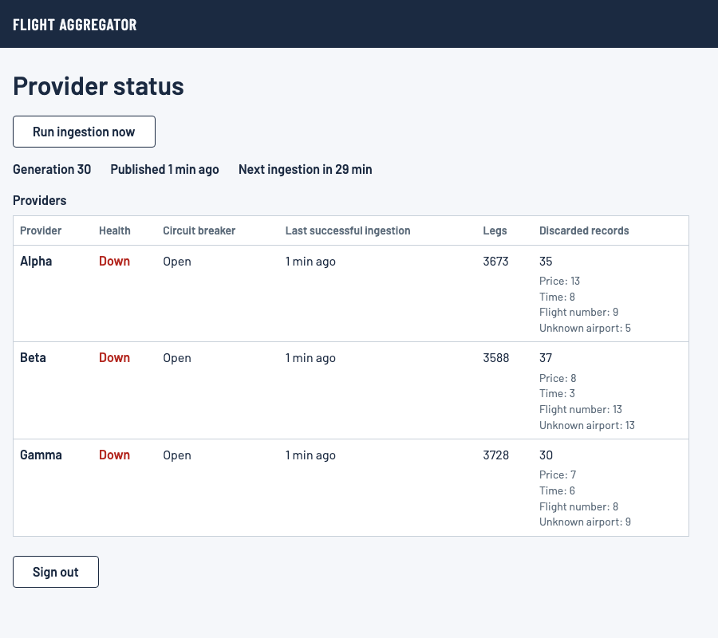

  *Every breaker open after failed price checks, before any run has kept the legs.*
- **Down** with "Kept from the last good ingestion": the last run could not download that provider, so the inventory keeps its legs from an earlier run. Customers still find its flights, at the older prices.

To check that a provider is back, wait a minute and press **Run ingestion now**: a successful run turns it "Up" and its breaker "Closed". The aggregator's own health, `http://localhost:8080/health`, reads `DEGRADED`, still with status `200`, while any provider is not up; the search keeps working.

### The stack is slow or does not start on an older machine

The README covers this: [Minimum hardware](../../README.md#minimum-hardware) and [On an older or slower machine](../../README.md#on-an-older-or-slower-machine). In short: give Docker at least 4 GB of memory, expect a slow first start, and start an ingestion by hand if the first one failed.

## Glossary

- **Itinerary:** a trip from one airport to another, made of one or more legs. Each result card is one itinerary.
- **Leg:** one flight, from take-off to landing, with its airline and flight number.
- **Layover:** the wait at an airport between two legs; a stop.
- **Re-price:** the live price check made when you open a card. It asks the providers to confirm the price of every leg.
- **Ingestion:** a run that downloads every provider's flights, checks and combines them into itineraries, and publishes them as a new generation. It runs at startup, every 30 minutes, and on demand.
- **Generation:** the number of the published inventory; each publication, an ingestion or a background refresh of one airport's flights, adds one.
- **Provider (GDS):** a source of flights. A GDS (global distribution system) sells airline seats to travel sites. The demo has three mock providers, Alpha (JSON), Beta (XML) and Gamma (CSV).
- **Circuit breaker:** a guard in front of each provider. After repeated failures it opens and refuses calls for 60 seconds, so a failing provider does not slow everything down; then it half-opens to test the provider, and closes again when the provider answers.
